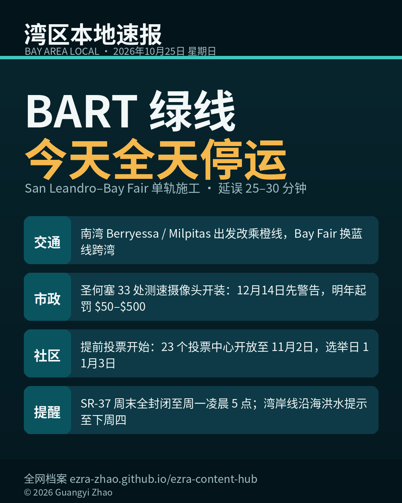

《湾区本地速报》首期，2026年10月25日，星期日，五条本地新闻：

**主打交通**：BART 官方通告，今天 San Leandro 到 Bay Fair 之间清理轨道植被，双轨改单轨，施工到傍晚六点。绿线全天停运，全部 50 个车站仍有车到。南湾从 Berryessa 和 Milpitas 出发改乘橙线，跨湾在 Bay Fair 换蓝线；橙线、蓝线今天都加长到八节车厢。这一段官方预计延误 25 到 30 分钟。

**市政**：圣何塞测速安全摄像头开始安装，全市 33 处、覆盖十个区，州法 AB 645 五年试点。12 月 14 日起先开 60 天警告期，超速 11 英里以上会被拍；正式罚单 2027 年初开始，罚金 50 到 500 美元。今年以来圣何塞已有 41 起交通死亡。

**社区**：11 月 3 日大选提前投票已经开始。圣克拉拉县 23 个投票中心 10 月 24 日起开放，每天 9:00–17:00，开到 11 月 2 日；县选务处（1555 Berger Drive）周末同时间。全县 100 多个官方选票投递箱已启用。

**提醒**：SR-37（Vallejo–Sonoma）周末全封闭至周一凌晨 5:00，Caltrans 抬高路面防洪，绕行先查 511。国家气象局对旧金山湾岸线发布沿海洪水提示：这周高潮时段低洼岸边可能漫水，持续到下周四 15:00。今天湾区天气平稳，最高温约 70°F。

来源：[BART 官方通告](https://www.bart.gov/news/articles/2026/news20261023) · 圣何塞市府测速摄像头项目页与 AP 报道 · [圣克拉拉县选务处投票中心公告](https://www.sccvote.org) · Caltrans District 4 通告 · [国家气象局湾区办公室](https://forecast.weather.gov/product.php?site=NWS&issuedby=MTR&product=AFD&format=CI&version=3&highlight=on&glossary=0)

数字证据说明：BART 通告、投票中心时段、洪水提示为 A 级（官方原文）；测速摄像头细节为 B 级（市府文件 + 多家报道交叉）；SR-37 封闭为 B 级（Caltrans 通告经县交通局转发）。

*《湾区本地速报》为《代码与诗篇》新闻矩阵第 8 档，每日早上更新。播报版（音频/视频）同日发布于 YouTube「Ezra Daily 每日速报」。© 2026 Guangyi Zhao*
