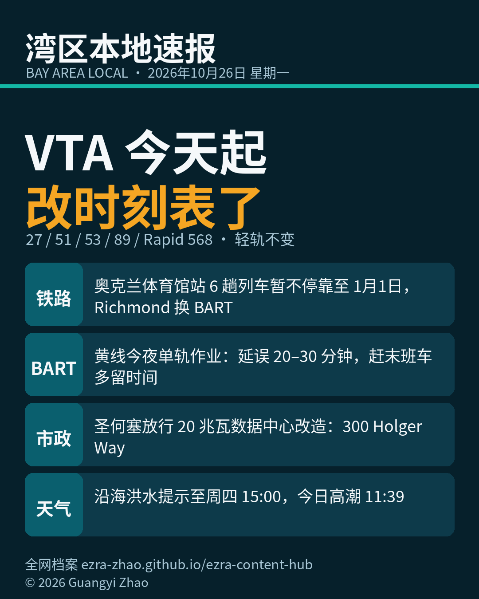

《湾区本地速报》第二期，2026年10月26日，星期一，五条本地新闻：

**主打交通**：VTA 官方通告，新一轮班次调整今天起生效。27路、51路、53路、89路与 Rapid 568路微调部分工作日班次改善换乘，53路还配合了 Cupertino Middle School 的放学时间；轻轨不变。下一次调整是2027年1月11日。出门前请先查官网新时刻表，别按老时间等车。

**铁路**：Capitol Corridor 通告，今天起 Oakland Coliseum 站因站外照明不足，6趟列车暂时不停靠，持续到2027年1月1日：工作日521、547、550次，周末746、747、748次。其他站照常，车票相邻站通用，官方建议在 Richmond 换乘 BART。圣何塞北上请留意。

**BART**：官方日程中，10月26日是黄线作业日。今夜 Lafayette 到 Pleasant Hill 做轨道作业，零点起双轨改单轨到明早开班前，夜间预计延误20到30分钟。赶末班车请多留时间。

**市政**：圣何塞市议会全票驳回一项环保上诉，放行 300 Holger Way 的数据中心改造。这栋楼现由 Nvidia（英伟达）租用做研发，开发商 Menlo Equities 计划改成20兆瓦数据中心；市议会维持 infill 豁免认定，免做完整 CEQA 环评审查。时点在市里新规生效前几周。

**天气提醒**：国家气象局更新沿海洪水提示：湾岸线到周四下午3点，高潮时低洼地带可能漫水，最高1.9英尺；半岛海岸一段今天上午9点起加入。今天11:39高潮，旧金山潮位高出正常1.6英尺。开车别绕路障、别进看不清深浅的积水。

来源：[VTA 官方服务变更页](https://www.vta.org/servicechange) · [Capitol Corridor 官方通告](https://www.capitolcorridor.org/blogs/get_on_board/temporary-service-disruption-at-oakland-coliseum-station-10-26-26-1-1-2027/) · [BART 官方通告](https://www.Bart.Gov/news/articles/2025/news20250326-1) · [The Registry 2026-10-26 报道](https://news.theregistrysf.com/san-jose-council-rejects-appeal-clears-menlo-equities-20-mw-data-center-conversion-at-nvidia-leased-300-holger-way/) · [国家气象局湾区办公室 Coastal Hazard Message](https://forecast.weather.gov/product.php?format=CI&glossary=1&issuedby=MTR&product=CFW&site=LSX&version=1)

数字证据说明：VTA 调整、Capitol Corridor 停靠变更、BART 作业、洪水提示为 A 级（官方原文）；数据中心决议为 B 级（The Registry 当日报道导语已核事实，付费墙后细节未取）。

*《湾区本地速报》为《代码与诗篇》新闻矩阵第 8 档，每日早上更新。播报版（音频/视频）同日发布于 YouTube「Ezra Daily 每日速报」。© 2026 Guangyi Zhao*
