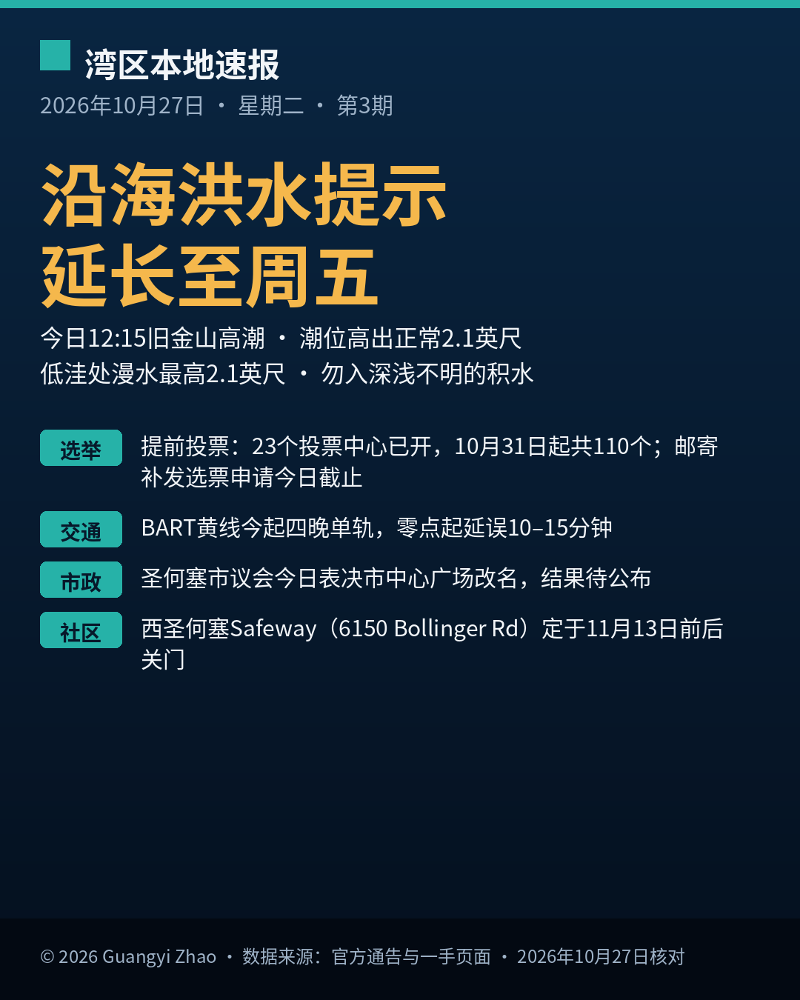

《湾区本地速报》第三期，2026年10月27日，星期二，五条本地新闻：

**主打天气**：国家气象局今早更新，沿海洪水提示持续到周五下午5点。旧金山湾等湾岸线低洼地带，漫水最高可达2.1英尺。今天中午12:15，旧金山潮位高出正常2.1英尺，马林县湾岸影响更明显。开车别绕路障，别进深浅不明的积水。

**选举提醒**：圣克拉拉县选举官呼吁提前投票。23个投票中心已经开放，10月31日起增至110个；全县111个官方投递箱全天可用。邮寄补发选票，申请截止就是今天。最后一周寄回选票，建议改投投递箱，或去投票中心。

**交通**：BART黄线今起连续四晚单轨作业，到10月30日为止，在 Pleasant Hill 到 Concord 之间安装光纤。作业从午夜前开始，到次日开班前结束，零点起预计延误10到15分钟。赶末班车请预留时间。

**市政**：圣何塞市议会定于今天表决市中心 Plaza de Cesar Chavez 的改名，公园与休闲委员会推荐新名 Plaza del Pueblo de San Jose。结果尚未公布，本档明天跟进确认。

**社区**：西圣何塞一家 Safeway 超市定于11月13日前后关门，地址在 6150 Bollinger Road。公司确认，员工保留工作、调往附近门店；最近的另一家在 5146 Stevens Creek Boulevard，不到一英里。常去采购的家庭请提前改路线。

来源：[国家气象局旧金山办公室 Coastal Hazard Message（2026-10-27 05:41 PDT）](https://forecast.weather.gov/wwamap/wwatxtget.php?cwa=usa&wwa=Coastal%20Flood%20Advisory) · [圣克拉拉县新闻中心 2026-10-26](https://news.santaclaracounty.gov/registrar-urges-voters-cast-ballots-early-nov-3-election-approaches) · [圣克拉拉县选民登记处选举页](https://vote.santaclaracounty.gov/elections/november-3-2026-general-election) · [BART 官方通告](https://www.bart.gov/news/articles/2026/news20260902) · [ABC7 报道（The Californian 2026-10-27 转述）](https://www.thecalifornian.com/story/news/local/2026/10/27/salinas-cesar-chavez-name-park-library/92448750007/) · [KTVU 报道](https://ktvu.com/news/bay-area-city-is-set-be-latest-lose-safeway-store)

数字证据说明：洪水提示、提前投票、BART 作业为 A 级（官方原文）；广场改名表决与 Safeway 关门为 B 级（可靠媒体报道，改名只报定于今日表决、不报结果；Safeway 为发言人向 KTVU 确认）。

*《湾区本地速报》为《代码与诗篇》新闻矩阵第 8 档，每日早上更新。播报版（音频/视频）同日发布于 YouTube「Ezra Daily 每日速报」。© 2026 Guangyi Zhao*
