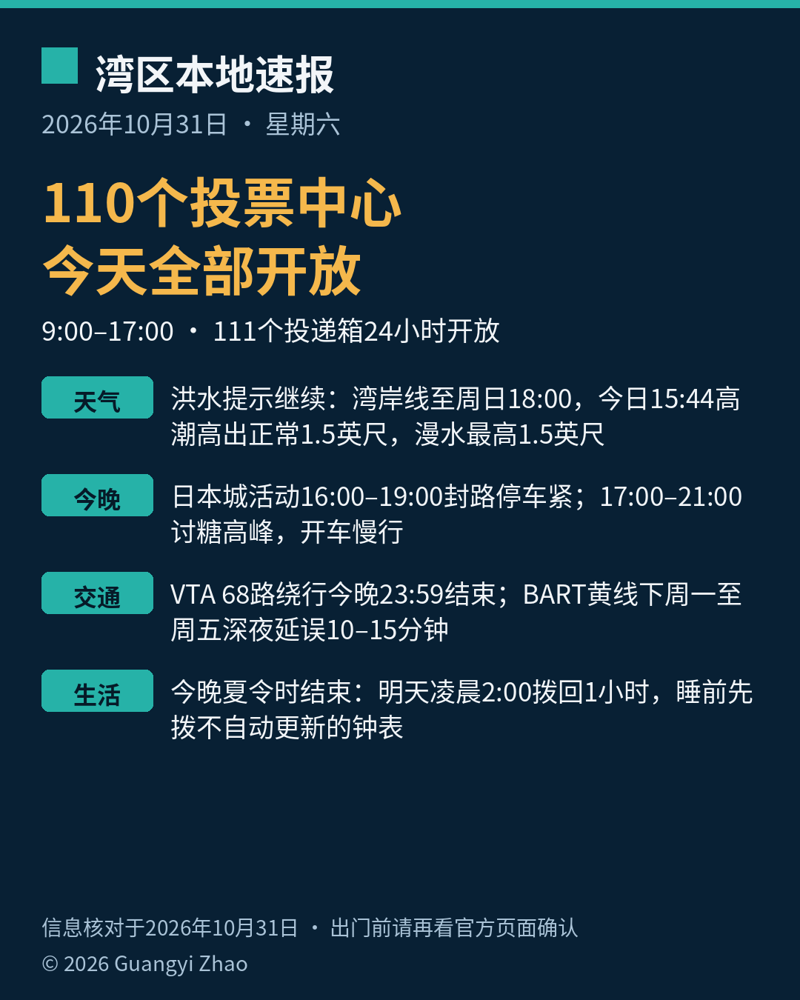

《湾区本地速报》第七期，2026年10月31日，星期六，五条本地新闻：

**主打选举**：圣克拉拉县余下87个投票中心今天全部开放，全县共110个，每天上午9点到下午5点，选举日（11月3日）上午7点到晚上8点。任何一个投票中心都能亲投、交回邮寄选票、领替换选票，没赶上登记期限的还能同日条件登记。Milpitas Library 那个点时间不同，10月31日到11月2日是上午10点到下午6点。全县111个官方选票投递箱24小时开放至选举日晚上8点。县选举官提醒：邮寄回票建议提前一周寄出，最后一周改用投递箱或投票中心最稳妥——邮局不保证当日邮戳，邮戳晚于11月3日的选票依法不能计。

**天气**：国家气象局今早（10月31日4:45）更新，沿海洪水提示继续：湾岸线（旧金山湾、圣巴勃罗湾、蒙特雷湾）管到周日（11月1日）下午6点，太平洋海岸段到今晚6点结束。低洼近岸漫水最高1.5英尺（昨天的口径是1.9英尺，今天下调）。今天下午3:44，旧金山高潮7.3英尺、高出正常1.5英尺；周日下午3:59潮位6.8英尺，继续回落。马林县湾岸影响更明显。开车别绕路障，别进深浅不明的积水。

**今晚社区与安全**：圣何塞日本城万圣节活动今天举行：中午12点艺术展开幕，下午1点滑板日开始，下午4点节庆活动开始、太鼓开场，晚上7点结束。附近街道封闭、停车有限，主办方建议坐公交或拼车。圣何塞消防局万圣节安全提示：今晚5点到9点是讨糖高峰，驾驶请尽量避开这个时段、在居民区慢行、留意路边和停放车辆间穿出的孩子；孩子讨糖请成人陪同（12岁以下）、带手电或贴反光条、在路口过街。

**交通两条**：VTA 68路在 Morgan Hill 因 Upper Llagas 防洪工程绕行，改走 Old Monterey Rd、Llagas Rd 一带，到今晚（10月31日）11:59结束，绕行沿线招手可以停，明天起恢复原线（以 VTA 后续通告为准）。BART 黄线下一轮单线施工是下周一到周五（11月2到6日）深夜，零点起延误10到15分钟，末班换乘会协调，乘客都能到达终点。

**生活提醒**：今晚夏令时结束。明天（11月1日）凌晨2点，时钟拨回一小时，回到凌晨1点。今晚睡前先把家里不自动更新的挂钟、车载时钟拨好。当晚能多睡一小时，但明天的天黑会明显提早（湾区11月1日日落约下午5:11），傍晚出门请按新时间算。

来源：[圣克拉拉县新闻中心 2026-10-26（投票中心，10-29更新）](https://news.santaclaracounty.gov/registrar-urges-voters-cast-ballots-early-nov-3-election-approaches) · [圣克拉拉县选举官官网（提前投票与 Milpitas Library 时段例外）](https://vote.santaclaracounty.gov/early-voting) · [国家气象局旧金山办公室 Coastal Hazard Message（2026-10-31 04:45 PDT）](https://forecast.weather.gov/wwamap/wwatxtget.php?cwa=usa&wwa=Coastal%20Flood%20Advisory) · [San Jose Taiko 官网（日本城万圣节，主办方）](https://taiko.org/halloween) · [圣何塞市政府 SJFD 万圣节安全页](https://www.sanjoseca.gov/your-government/departments-offices/fire-department/public-education/seasonal-holiday-safety/halloween-safety) · [VTA 官网 Service Alert（68路绕行）](https://www.vta.org/go/service-alerts/68/route-68-reroute-due-upper-llagas-flood-protection-project) · [BART 官网通告（黄线单线施工）](https://www.bart.gov/news/articles/2026/news20260902) · [USA TODAY 2026-10-29（夏令时）](https://www.usatoday.com/story/news/nation/2026/10/29/states-exempt-daylight-saving-time-list/92438557007/)

数字证据说明：投票中心、洪水提示、日本城活动、VTA 绕行与 BART 施工为 A 级（官方原文，核对日期 2026-10-31）；夏令时为 B 级（可靠媒体报道，全国统一联邦规则，并以湾区日出日落时刻交叉确认）；SJFD 安全页为消防局常设安全页，文中只作安全提示引用。

*《湾区本地速报》为《代码与诗篇》新闻矩阵第 8 档，每日早上更新。播报版（音频/视频）同日发布于 YouTube「Ezra Daily 每日速报」。© 2026 Guangyi Zhao*
