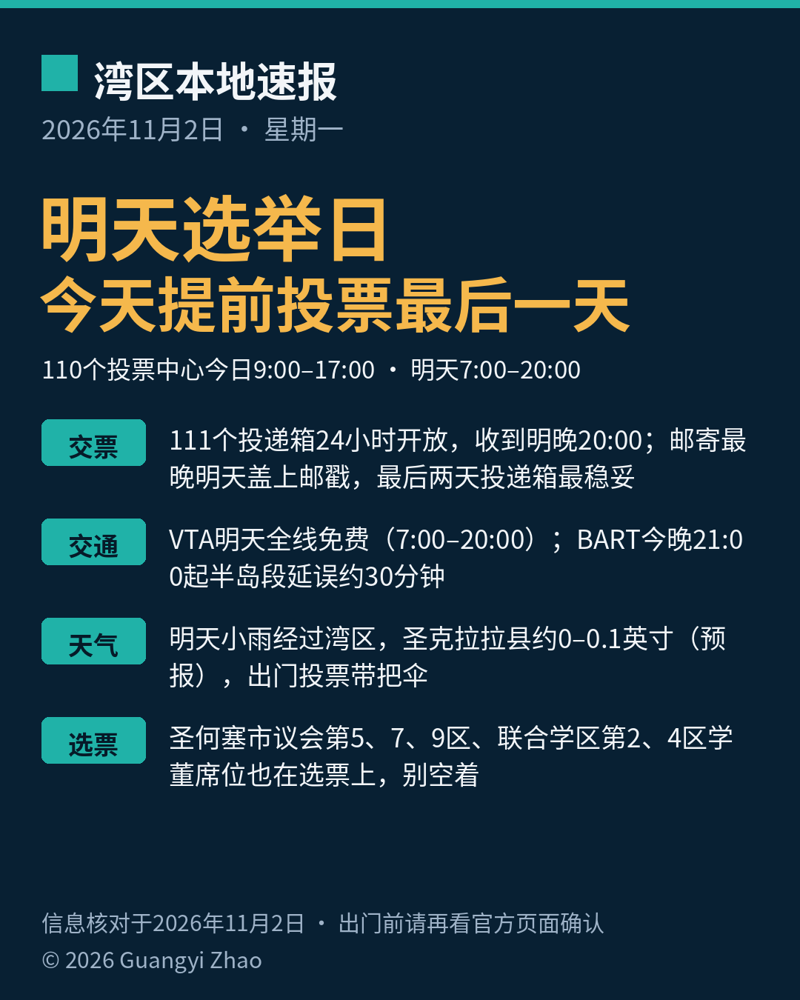

《湾区本地速报》第八期，2026年11月2日，星期一，五条本地新闻：

**主打选举**：明天（11月3日）就是选举日。今天是提前投票最后一天：圣克拉拉县110个投票中心今天开放至下午5点（Milpitas Library 那个点是上午10点到下午6点），选举日上午7点到晚上8点。任何一个投票中心都能亲投、交回邮寄选票、领替换选票，没赶上登记期限的还能同日条件登记。想避开选举日人潮，今天下班前顺路投掉最省事。

**交票提醒**：全县111个官方选票投递箱24小时开放，收到选举日（11月3日）晚上8点整。邮寄选票最晚明天盖上邮戳即算数，但县选举办公室提醒：到了最后两天别再寄，直接投投递箱或去投票中心交回最稳妥。

**交通**：明天选举日，VTA公交和轻轨全线免费，上车时段上午7点到晚上8点，晚上8点01分起恢复收费。今晚走BART半岛线的留意：晚上9点起，Millbrae、旧金山国际机场（SFO）、Daly City一带因列车控制系统现代化施工延误约30分钟（周日至周四每晚都有）。

**天气**：今天圣何塞多云，最高约69华氏度。明天选举日白天有一波小雨经过湾区，国家气象局预报圣克拉拉县雨量不大、约0到0.1英寸（预报口径），出门投票顺手带把伞。本县目前没有生效中的气象警报。

**选票内容**：明天要选的不只有国会和州级席位——圣何塞市议会第5、7、9区，圣何塞联合学区第2、4区的学董席位也在选票上，这些席位管的是身边的路、治安和自家孩子学校的事，别空着。

来源：[圣克拉拉县选举官官网（提前投票）](https://vote.santaclaracounty.gov/early-voting) · [圣克拉拉县选举官官网（投递箱与提前投票信息）](https://vote.santaclaracounty.gov/vote-mail/official-ballot-drop-box-sites-and-early-voting-information) · [VTA官网（选举日免费通告）](https://www.vta.org/) · [BART官网Service Advisory](https://www.bart.gov/service-advisories/limited-bart-service-update) · [国家气象局旧金山湾区办公室预报讨论（2026-11-01 14:34 PST）](https://forecast.weather.gov/product.php?site=NWS&issuedby=MTR&product=AFD&format=txt&version=5&glossary=0&highlight=on) · [圣克拉拉县选举官官网（2026年11月3日大选提名通告）](https://vote.santaclaracounty.gov/nomination-period-opens-next-week-november-3-2026-general-election)

数字证据说明：投票中心时段、投递箱、VTA免费、BART延误与选票席位为 A 级（官方原文，核对日期 2026-11-02）；明日雨量为国家气象局预报口径（A 级来源、预报性质）；今日最高温约69华氏度为 weather.com 当日预报（B 级）。

*《湾区本地速报》为《代码与诗篇》新闻矩阵第 8 档，每日早上更新。播报版（音频/视频）同日发布于 YouTube「Ezra Daily 每日速报」。© 2026 Guangyi Zhao*
