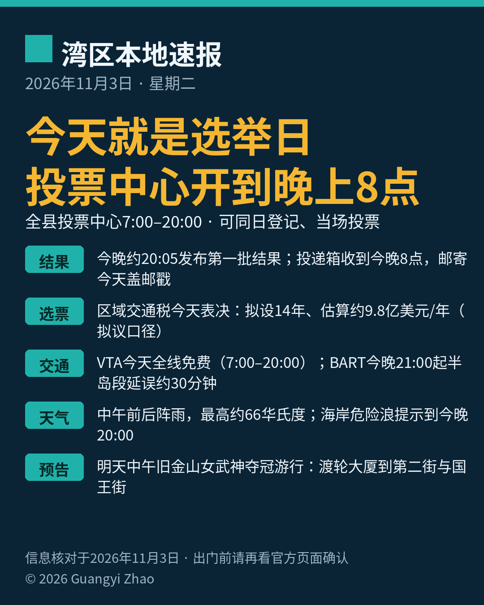

《湾区本地速报》第九期，2026年11月3日，星期二，五条本地新闻：

**主打选举日**：今天就是选举日。圣克拉拉县投票中心今天上午7点开到晚上8点，任何一个投票中心都能同日登记、当场投票。官方选票投递箱也开放到今晚8点整；邮寄选票今天盖上邮戳还来得及，但县选举办公室提醒，最后一天直接交投递箱或去投票中心最稳妥。今晚8点05分左右，县选举官网站会发布第一批半官方计票结果。

**选票大题**：今天的选票上有一道大题——区域交通提案 Measure RTM。圣克拉拉等五县今天表决，拟设14年销售税：圣克拉拉等四县半美分、旧金山1美分，估算每年筹约9.8亿美元，主要保 BART、Caltrain、Muni 与 AC Transit 的运营；若不过关，这几家机构已公布大幅减班预案。这笔钱花不花，今天由选民定。（拟议口径，数字为多源一致报道，未经一手原文终核，证据等级 B。）

**交通**：今天选举日，VTA 公交和轻轨全线免费，上车时段上午7点到晚上8点，晚上8点01分起恢复收费。今晚坐 BART 半岛线的留意：晚上9点起，Millbrae、旧金山国际机场（SFO）、Daly City 一带因列车控制系统现代化施工，延误约30分钟（周日至周四每晚都有，今晚适用）。

**天气与安全**：今天圣何塞中午前后有阵雨，最高约66华氏度（预报口径），出门投票带把伞。太平洋海岸的海滩危险提示持续到今晚8点：疯狗浪和强离岸流风险升高，浪会无预警冲上岸，去海边别上礁石、别背对海浪。

**明天预告**：明天（11月4日，周三）中午12点到约下午2点，旧金山为 WNBA 冠军金州女武神队举行夺冠游行，从渡轮大厦（Ferry Building）沿 Embarcadero 走到第二街与国王街（King）。球迷早上9点起可沿路占位；周边道路明天凌晨起陆续封闭，Muni 的 F、N 线约9点30分起暂停，BART 将加开列车，想去看的坐公共交通最省心。

来源：[圣克拉拉县选举官官网（提前投票）](https://vote.santaclaracounty.gov/early-voting) · [VTA官网（选举日免费通告）](https://www.vta.org/go/service-alerts/free-fares-vta-bus-and-light-rail-election-day-november-3-2026) · [BART官网（游行交通指南）](https://www.bart.gov/news/articles/2026/news20261029)

数字证据说明：投票中心与投递箱时段、计票结果发布时间、VTA 免费时段为 A 级（官方原文，核对日期 2026-11-03）；BART 延误与游行安排为 A/B 级（官方通告与指南，多源一致）；区域交通提案数字为 B 级（多源一致报道，拟议口径）；今日最高温与阵雨为 weather.com 当日预报（B 级，预报口径）；海滩危险提示为国家气象局原文经多源转述（B 级）。

*《湾区本地速报》为《代码与诗篇》新闻矩阵第 8 档，每日早上更新。播报版（音频/视频）同日发布于 YouTube「Ezra Daily 每日速报」。© 2026 Guangyi Zhao*
