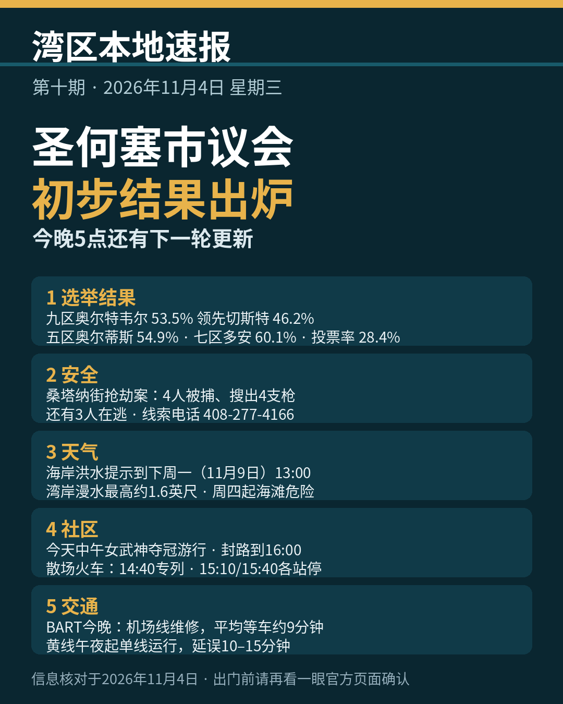

《湾区本地速报》第十期，2026年11月4日，星期三，五条本地新闻：

**主打·市议会初步结果**：截至昨晚（11月3日）11点21分的早期结果，圣何塞市议会三个区领先者都已明朗。第九区是本届唯一的开放席位，Genny Altwer 得票 53.5%（8,553 票），领先 Gordon Chester 的 46.2%（7,383 票）；第五区现任 Peter Ortiz 54.9%（5,883 票）领先 Nora Campos 的 44.8%（4,798 票）；第七区现任 Bien Doan 60.1%（6,718 票）领先 Van Le 的 39.6%（4,429 票）。全县投票率 28.4%。先别当成最终结果：邮寄选票只要在选举日或之前盖上邮戳、11月10日或之前寄到县里，照样计票。下一轮结果更新就在今天下午 5 点前，留意县选举官网站。

**安全**：圣何塞警方周二通报，7月23日凌晨发生在桑塔纳街（Santana Row）350 号段一家酒店前的持械抢劫案，7 名嫌犯中已有 4 人在 10月21日于 Lathrop 被捕，搜出 4 支枪；还有 3 人在逃。有线索请打 408-277-4166，找抢劫案组办案警探。

**天气与安全**：国家气象局海岸洪水提示已经生效，持续到下周一（11月9日）下午 1 点，旧金山湾沿岸低洼地带可能漫水，最高约 1.6 英尺，伴个别道路封闭；周四（11月5日）清晨到周六（11月7日）晚上还有海滩危险提示，碎浪 12 到 16 英尺，疯狗浪与强离岸流风险升高，别下水、别上礁石。

**社区大事**：今天中午 12 点到约下午 2 点，旧金山为 WNBA 冠军金州女武神队举行夺冠游行，从渡轮大厦（Ferry Building）沿 Embarcadero 走到第二街与国王街（King）。球迷早上 9 点起可沿路占位，海滨大道周边封路到下午 4 点，BART 加开列车。散场坐火车最稳：Caltrain 南下专列下午 2 点 40 分自旧金山站发车，3 点 10 分、3 点 40 分还有两班改停各站。

**交通**：今晚坐 BART 留意两处。晚上 10 点到明早 6 点，去奥克兰机场（OAK）的接驳线做维修，平均等车约 9 分钟；黄线今晚午夜起单线运行，延误 10 到 15 分钟，深夜出门多留一点时间。

来源：[San José Spotlight（第九区）](https://sanjosespotlight.com/genny-altwer-leads-in-san-jose-d9-city-council-race/) · [San José Spotlight（第五区）](https://sanjosespotlight.com/early-results-show-peter-ortiz-ahead-in-san-jose-district-5-race/) · [San José Spotlight（第七区）](https://sanjosespotlight.com/district-7-councilmember-bien-doan-pulls-ahead/) · [圣克拉拉县选举官官网（邮寄选票退回）](https://vote.santaclaracounty.gov/vote-mail/returning-vote-mail-ballots) · [KION（桑塔纳街抢劫案）](https://kioncentralcoast.com/news/2026/11/03/suspects-arrested-in-san-jose-santana-row-armed-robbery-more-suspects-at-large/) · [旧金山市政府（游行官方页）](https://www.sf.gov/event-20261104-golden-state-valkyries-championship-parade-2026) · [Caltrain 官网（游行专列）](https://www.caltrain.com/news/caltrain-connects-fans-valkyries-championship-parade) · [BART 官网（机场线维修通告）](https://www.bart.gov/news/articles/2026/news20261023-0)

数字证据说明：邮寄选票规则、Caltrain 专列班次、BART 两则通告为 A 级（官方原文，核对日期 2026-11-04）；市议会三区百分比为 B 级（San José Spotlight 三篇报道互相一致，初步结果口径）；抢劫案要点为 B 级（圣何塞警察局新闻稿经 KION/CBS 报道）；海岸洪水提示为 A/B 级（国家气象局原文经警报镜像逐字核对）。

*《湾区本地速报》为《代码与诗篇》新闻矩阵第 8 档，每日早上更新。播报版（音频/视频）同日发布于 YouTube「Ezra Daily 每日速报」。© 2026 Guangyi Zhao*
