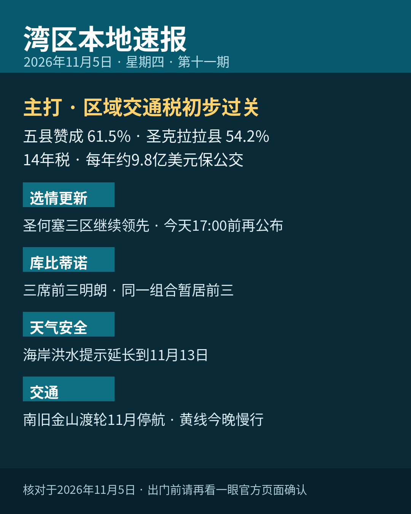

title: 区域交通税初步过关，五县赞成61.5%
date: 2026-11-05
series: baylocal
author: Guangyi Zhao
---

《湾区本地速报》第十一期，2026年11月5日，星期四，五条本地新闻：

**主打·区域交通税 RTM 初步过关**：都会交通委员会（MTC）11月4日晨公布，截至11月4日早上 7 点 30 分，五县已计票 1,160,786 张，赞成 714,460 张、占 61.5%，反对 446,326 张；圣克拉拉县赞成 54.2%（157,669 票），五县全部过半。措施为 14 年销售税：圣克拉拉等四县加 0.5%、旧金山加 1%，预计每年筹到约 9.8 亿美元，保住 BART、Caltrain、Muni 与公交不大幅裁减。先别当成最终结果：MTC 注明尚有许多邮寄票、条件登记与临时票未计，结果须由县选务处认证，稿中口径为初步结果。

**选情更新**：截至11月4日下午 5 点，圣何塞第五区现任 Peter Ortiz 53.9%（6,109 票）领先 Nora Campos 44.9%（4,995 票）；第九区 Genny Altwer 53.5%（9,020 票）领先；第七区现任 Bien Doan 60.1%（6,832 票）领先。全县投票率 29.6%，全县约 337,600 张选票尚未处理；下一轮结果更新预计今天（11月5日）下午 5 点前公布。库比蒂诺三席暂居前三的都是同一竞选组合：John Tang 18.5%（4,651 票）、现任议员 J.R. Fruen 17.1%（4,293 票）、规划委员 Seema Sharma Lindskog 16.5%（4,136 票），前三名当选。

**天气与安全**：国家气象局今晨（11月5日 2 点 05 分）新版通告，把旧金山湾沿岸的海岸洪水提示延长到下周五（11月13日）下午 4 点（此前一版到11月9日），湾岸低洼地带可能漫水最高约 1.6 英尺，伴低洼设施淹水与个别道路封闭；旧金山潮位站今天早上 8 点 35 分高潮预计高出正常 1.3 英尺。海滩危险提示持续到下周一（11月9日）晚上，碎浪 12 到 16 英尺，疯狗浪与强离岸流风险升高，别下水、别上礁石。

**交通·渡轮**：南旧金山渡轮线整个 11 月停航：Oyster Point 码头疏浚，航线 11月1日至30日暂停，预计 12月1日按现行时刻恢复。停航期间官方建议改用 BART、Caltrain 或 Commute.org 接驳车，出门前先查时刻。

**交通·BART**：BART 黄线今晚继续单线施工（Contra Costa 段），午夜起延误 10 到 15 分钟；这一轮施工窗口到 11月6日结束，今晚是最后一晚，深夜乘车多留一点时间。

来源：[都会交通委员会 MTC（RTM 初步结果）](https://mtc.ca.gov/news/bay-area-voters-show-strong-support-public-transit) · [San José Spotlight（第五区）](https://sanjosespotlight.com/early-results-show-peter-ortiz-ahead-in-san-jose-district-5-race/) · [San José Spotlight（库比蒂诺）](https://sanjosespotlight.com/three-candidates-ahead-in-cupertino-city-council-election/) · [国家气象局（海岸洪水提示原文）](https://preview.weather.gov/wwamap/wwatxtget.php?cwa=sto&wwa=all) · [旧金山湾渡轮官网](https://sanfranciscobayferry.com/) · [BART 官网（黄线单线通告）](https://www.bart.gov/news/articles/2026/news20260902)

数字证据说明：RTM 初步结果、海岸洪水提示、渡轮停航与 BART 通告为 A 级（官方原文，核对日期 2026-11-05）；圣何塞与库比蒂诺选情百分比为 B 级（San José Spotlight 报道、初步结果口径，下一轮更新 11月5日 17:00 前）。

*《湾区本地速报》为《代码与诗篇》新闻矩阵第 8 档，每日早上更新。播报版（音频/视频）同日发布于 YouTube「Ezra Daily 每日速报」。© 2026 Guangyi Zhao*
