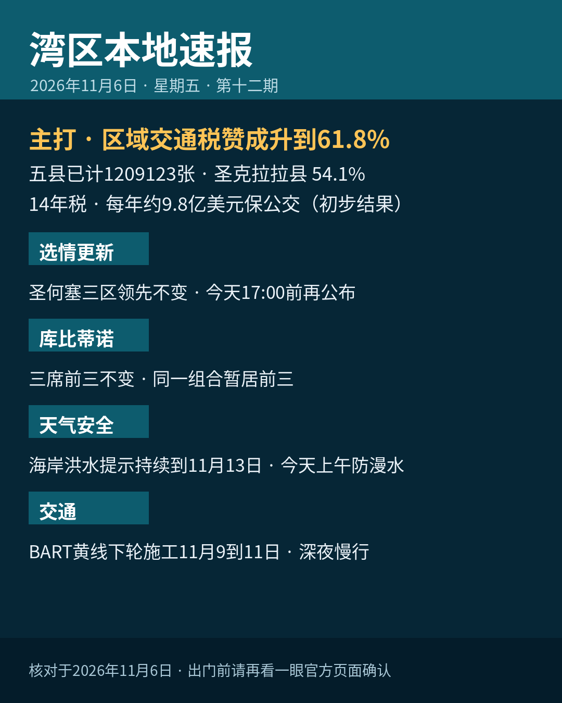

title: 区域交通税赞成升到61.8%
date: 2026-11-06
series: baylocal
author: Guangyi Zhao
---

《湾区本地速报》第十二期，2026年11月6日，星期五，五条本地新闻：

**主打·区域交通税 RTM 最新点票**：都会交通委员会（MTC）11月5日下午更新，截至11月5日下午 3 点 30 分，五县已计票 1209123 张，赞成 747055 张、占 61.8%，反对 462068 张；圣克拉拉县赞成 54.1%（164491 票），旧金山 77.9% 最高，五县全部过半。措施为 14 年销售税：圣克拉拉等四县加 0.5%、旧金山加 1%，预计每年筹到约 9.8 亿美元。先别当成最终结果：MTC 注明尚有许多邮寄票未计，结果须由县选务处认证，稿中口径为初步结果。

**选情更新**：截至11月5日约 17 点 11 分，圣何塞第五区现任 Peter Ortiz 54.7%（6773 票）领先；第七区现任 Bien Doan 60.73%（7541 票）领先；第九区 Genny Altwer 53.6%（10064 票）领先。全县投票率 33.3%，全县约 296000 张选票尚未处理；下一轮结果更新预计今天（11月6日）下午 5 点前公布。

**库比蒂诺**：三席暂居前三的还是同一竞选组合：John Tang 18.15%（5475 票）、现任议员 J.R. Fruen 16.7%（5042 票）、规划委员 Seema Sharma Lindskog 16.1%（4883 票），前三名当选。

**天气与安全**：国家气象局海岸洪水提示持续到下周五（11月13日）下午 4 点，湾岸低洼地带可能漫水最高约 1.6 英尺；今天（11月6日）上午 9 点 08 分旧金山潮位站高潮预计约 7.2 英尺、高出正常 1.4 英尺。海滩危险提示持续到下周一晚上，碎浪 12 到 16 英尺，别下水、别上礁石。

**交通·BART**：BART 黄线单线施工本轮到今天（11月6日）结束，下一轮 11月9日至11日，午夜起延误 10 到 15 分钟，深夜乘车提前留意。

来源：[都会交通委员会 MTC（RTM 最新点票）](https://mtc.ca.gov/news/bay-area-voters-show-strong-support-public-transit) · [San José Spotlight（第七区）](https://sanjosespotlight.com/district-7-councilmember-bien-doan-pulls-ahead/) · [San José Spotlight（库比蒂诺）](https://sanjosespotlight.com/three-candidates-ahead-in-cupertino-city-council-election/) · [国家气象局预报讨论](https://forecast.weather.gov/product.php?site=NWS&issuedby=mtr&product=AFD&format=CI&version=1&glossary=1&highlight=on) · [BART 官网（黄线单线通告）](https://www.bart.gov/news/articles/2026/news20260902)

数字证据说明：RTM 最新点票、海岸洪水提示与 BART 通告为 A 级（官方原文，核对日期 2026-11-06）；圣何塞与库比蒂诺选情百分比为 B 级（San José Spotlight 报道、初步结果口径，下一轮更新 11月6日 17 点前）。

*《湾区本地速报》为《代码与诗篇》新闻矩阵第 8 档，每日早上更新。播报版（音频/视频）同日发布于 YouTube「Ezra Daily 每日速报」。© 2026 Guangyi Zhao*
