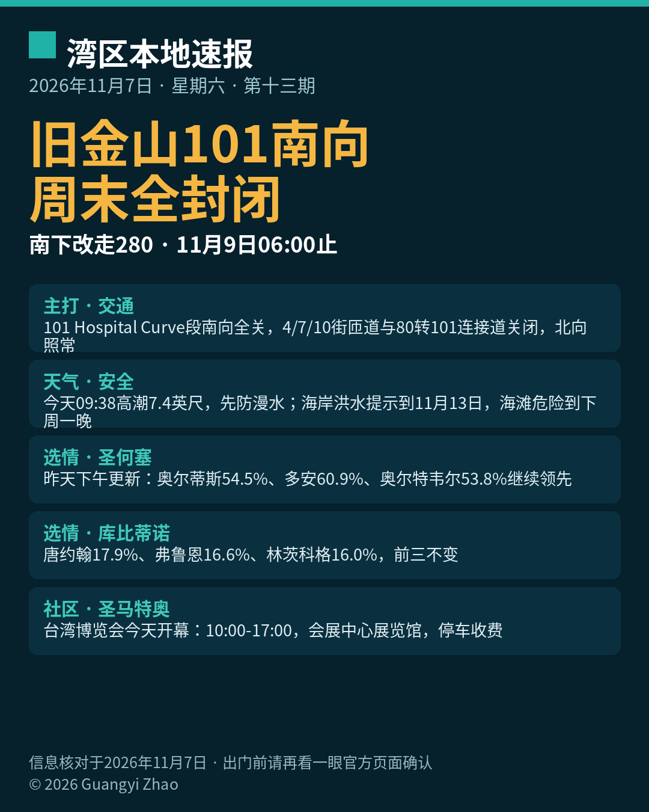

title: 旧金山101南向周末全封闭，南下改走280
date: 2026-11-07
series: baylocal
author: Guangyi Zhao
---

《湾区本地速报》第十三期，2026年11月7日，星期六，五条本地新闻：

**主打·交通**：加州交通局（Caltrans）旧金山高速公路翻修工程迎来最后一场周末全封闭：US-101 Bayshore 高速 Hospital Curve 段南向全部车道，自昨晚（11月6日）23 点起封闭至下周一（11月9日）早上 6 点，封闭路段在 17 街与 Cesar Chavez 之间，本周末完成最后两条南向车道的铺面。封闭期间 4 街、7 街、10 街上匝道关停，西行 80 号转北行 101 的连接道也关闭；北向车道照常通行。官方建议南下改走南向 280 高速，并预期会有延误；施工进度受天气影响，出门前请先看 Caltrans 页面确认。

**天气与安全**：国家气象局海岸洪水提示持续到 11月13日（周五）下午 4 点；今天（11月7日）上午 9 点 38 分旧金山潮位站高潮预计约 7.4 英尺、高出正常 1.6 英尺，湾岸低洼地带可能漫水最高约 1.6 英尺，明天上午高潮同为 7.4 英尺。海滩危险提示持续到下周一晚上，碎浪 12 到 16 英尺，别下水、别上礁石与防波堤。

**选情更新·圣何塞**：截至昨天下午（11月6日）5 点，圣何塞第五区现任 Peter Ortiz 54.5%（7415 票）领先 Nora Campos 45.2%（6152 票）；第七区现任 Bien Doan 60.9%（8173 票）领先 Van Le 38.9%（5222 票），Spotlight 称 Doan 有望成为十多年来首位在第七区连任的现任议员；第九区 Genny Altwer 53.8%（10907 票）领先 Gordon Chester 46.0%（9318 票）。全县投票率 36.9%，约 260900 张选票尚未处理，结果未经认证。

**选情更新·库比蒂诺**：三席暂居前三的仍是同一竞选组合：John Tang 17.9%（6098 票）、现任议员 J.R. Fruen 16.6%（5649 票）、规划委员 Seema Sharma Lindskog 16.0%（5448 票），前三名当选；同样为初步结果，待认证。

**社区大事**：台湾博览会（USA Taiwan Global Expo）今天与明天（11月7日至8日）在圣马特奥县会展中心展览馆举行，每日上午 10 点到下午 5 点，台湾美食、品牌、生活、健康、文化、旅游与科技产品集中展示，地址 1346 Saratoga Drive, San Mateo；门票经主办方渠道销售，会展中心停车收费。

来源：[加州交通局 Caltrans（101翻修项目页）](https://dot.ca.gov/caltrans-near-me/district-4/d4-projects/d4-san-francisco-freeway-and-road-rehabilitation) · [国家气象局海岸危险通告](https://forecast.weather.gov/showsigwx.php?warnzone=CAZ006&warncounty=CAC075&firewxzone=CAZ006&local_place1=San%20Francisco%20CA&product1=Flood+Watch&lat=37.775&lon=-122.41833) · [San José Spotlight（第七区）](https://sanjosespotlight.com/district-7-councilmember-bien-doan-pulls-ahead/) · [San José Spotlight（库比蒂诺）](https://sanjosespotlight.com/three-candidates-ahead-in-cupertino-city-council-election/) · [Sparknify 周末活动清单（台湾博览会）](https://www.sparknify.com/post/20261106-bay-area-epic-guide-1107-en)

数字证据说明：101 封闭通告与海岸洪水提示为 A 级（官方原文，核对日期 2026-11-07）；圣何塞与库比蒂诺选情、台湾博览会安排为 B 级（可靠媒体/主办方发布多源一致，选情为初步结果口径）。

*《湾区本地速报》为《代码与诗篇》新闻矩阵第 8 档，每日早上更新。播报版（音频/视频）同日发布于 YouTube「Ezra Daily 每日速报」。© 2026 Guangyi Zhao*
