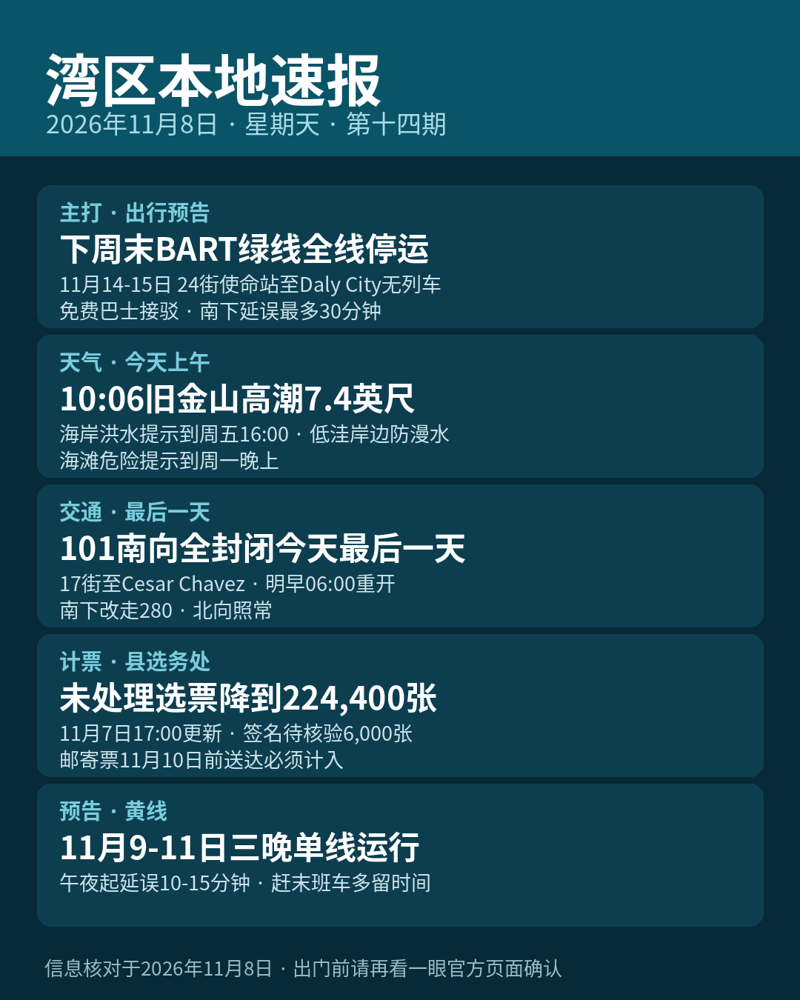

title: 下周末BART绿线全线停运，先记这一条
date: 2026-11-08
series: baylocal
author: Guangyi Zhao
---

《湾区本地速报》第十四期，2026年11月8日，星期天，五条本地新闻：

**主打·交通预告**：湾区捷运（BART）官方通告：下周末 11月14日（周六）与15日（周日），因新列车控制系统（CBTC）施工，24 街使命站与 Daly City 站之间不跑列车，绿线整个周末全线停运。接驳方面，三木县公交（SamTrans）跑 24 街使命站至 Daly City 的直达快线，旧金山公交（Muni）跑逐站慢线、经 Glen Park 与 Balboa Park 两站（两站无列车服务）。红线只开 Richmond 至 24 街使命站，蓝线只开 Dublin 至 24 街使命站；Daly City 至 Millbrae 段每 15 分钟一班，其余线路维持 20 分钟一班，全线发车时刻最多平移 3 分钟。往 24 街以南去的乘客预计延误最多 30 分钟。橙线为顶替被取消的绿线首班车，周六清晨 5 点 40 分、周日清晨 7 点 40 分各有一班自 Berryessa 站加开。另注意：Daly City 站两处地面停车场 11月13日至15日临时关闭配合接驳安排。

**天气与安全**：国家气象局 11月7日晚 8 点 09 分更新：海岸洪水提示在旧金山湾岸一带持续到 11月13日（周五）下午 4 点（另一组岸段持续到 11月10日中午）。今天（11月8日）上午 10 点 06 分，旧金山潮位站高潮预计 7.4 英尺、高出正常 1.6 英尺，湾岸低洼地带可能漫水最高约 1.6 英尺，低洼道路可能临时封闭。海滩危险提示持续到 11月9日（周一）晚上，去海边别下水、别上礁石。

**交通**：加州交通局（Caltrans）101 高速翻修工程最后一场周末全封闭今天是最后一天：US-101 Bayshore 高速 Hospital Curve 段南向全部车道，自 11月6日晚 11 点起封闭至明天（11月9日）早上 6 点，路段在 17 街与 Cesar Chavez 之间，本周末完成最后两条南向车道的铺面。封闭期间 4 街、7 街、10 街上匝道关停，西行 80 号转南向 101 的连接道关闭；北向车道照常。官方建议南下改走南向 280 高速并预期延误；施工受天气影响。

**计票更新**：圣塔克拉拉县选务处 11月7日下午 5 点更新未处理选票估计：全县还没处理完的选票估计还有 224,400 张，较前一天约 260,900 张减少 36,500 张。其中选举日及之前收到的邮寄票 196,000 张、选举日后收到的 15,500 张、附条件登记票 6,500 张、临时票 400 张，另有 6,000 张卡在签名核验。按加州选举法，邮寄选票只要在选举日当天或之前寄出、11月10日前送达，就必须计入；签名有问题的选民可在选举日后 22 天内提交核验声明。以上均为估计数，结果未经认证。

**交通预告**：BART 黄线 11月9日至11日连续三晚夜间施工：北康科德/马丁内斯（North Concord/Martinez）至匹兹堡/湾角（Pittsburg/Bay Point）之间改单线运行，施工自午夜前开始、通宵进行，午夜起乘客预计延误 10 到 15 分钟。官方表示 MacArthur 站的末班汇合与 Antioch 方向末班换乘会做好衔接，赶夜车请多留时间（下一轮单线日期为 11月17日至18日）。

来源：[BART 官方通告（11月14-15日巴士接驳与绿线取消）](https://www.bart.gov/news/articles/2026/news20261015) · [国家气象局海岸洪水提示](https://forecast.weather.gov/showsigwx.php?warnzone=CAZ006&warncounty=CAC075&firewxzone=CAZ006&local_place1=San+Francisco+CA&product1=Coastal+Flood+Advisory) · [加州交通局 Caltrans（101翻修项目页）](https://dot.ca.gov/caltrans-near-me/district-4/d4-projects/d4-san-francisco-freeway-and-road-rehabilitation) · [圣塔克拉拉县选务处未处理选票估计](https://vote.santaclaracounty.gov/elections/unprocessed-ballot-estimates) · [BART 官方通告（黄线单线）](https://www.bart.gov/news/articles/2026/news20260902)

数字证据说明：本期五条均为 A 级（官方原文：BART、国家气象局、Caltrans、县选务处，核对日期 2026-11-08）；选票数字为选务处估计口径、结果未认证，稿中已注明。

*《湾区本地速报》为《代码与诗篇》新闻矩阵第 8 档，每日早上更新。播报版（音频/视频）同日发布于 YouTube「Ezra Daily 每日速报」。© 2026 Guangyi Zhao*
