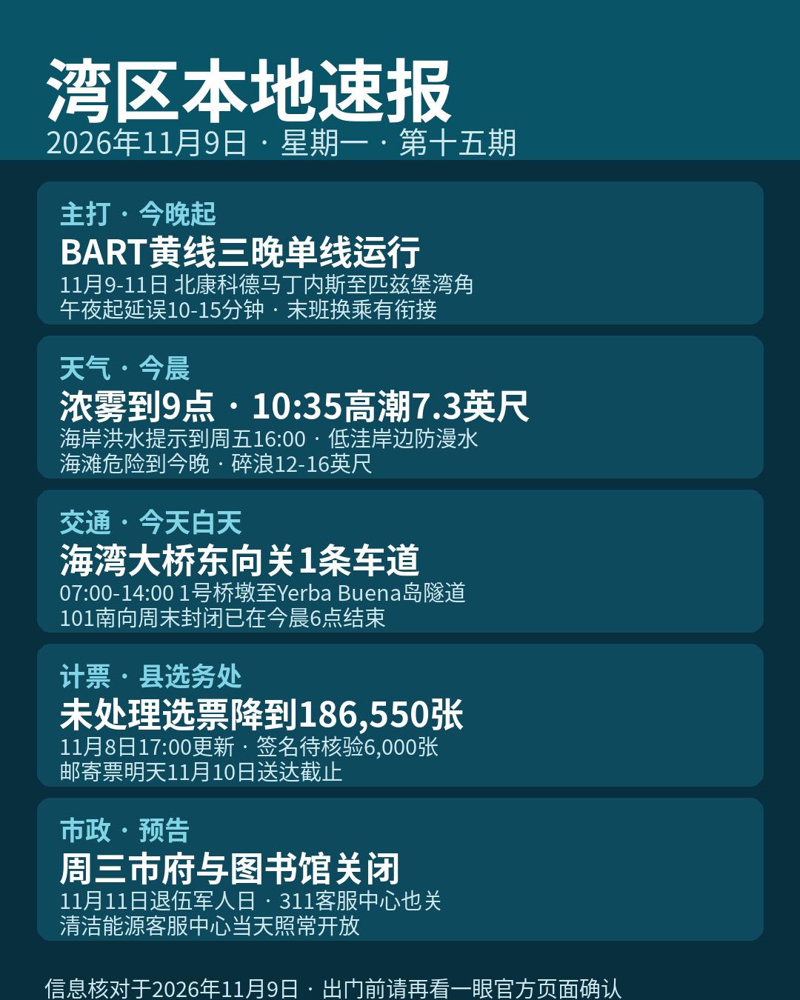

title: BART黄线今晚起三晚单线，午夜后先多留十几分钟
date: 2026-11-09
series: baylocal
author: Guangyi Zhao
---

《湾区本地速报》第十五期，2026年11月9日，星期一，五条本地新闻：

**主打·交通**：湾区捷运（BART）官方通告：黄线在 Contra Costa 段因数字铁路（Digital Railway）光纤施工改单线运行，本轮日期为 11月9日至11日，区段在北康科德/马丁内斯（North Concord/Martinez）站与匹兹堡/湾角（Pittsburg/Bay Point）站之间。施工在午夜前开始、通宵进行，到次日正常运营开始前结束；午夜起乘客预计延误 10 到 15 分钟。官方表示 MacArthur 站的末班汇合（Grand Meet）与 Antioch 方向接驳列车的末班换乘会做好衔接，全部乘客都能到达目的地。下一轮单线日期为 11月17日至18日。

**天气与安全**：国家气象局今晨 7 点 01 分发布浓雾提示：旧金山与旧金山湾岸一带浓雾有效至今天上午 9 点，能见度只有四分之一英里或更低，驾驶条件危险，请减速、开车灯、拉开车距。海岸方面，昨晚 7 点 50 分更新的海岸危险通告显示：海岸洪水提示持续到 11月13日（周五）下午 4 点，低洼岸边可能漫水最高约 1.6 英尺；今天上午 10 点 35 分，旧金山潮位站高潮预计 7.3 英尺、高出正常 1.5 英尺；海滩危险提示持续到今晚，碎浪可达 12 到 16 英尺，去海边别下水、别上礁石。

**交通**：加州交通局（Caltrans）项目页：今天白天东向 I-80 海湾大桥 1 号车道关闭，区段从 1 号桥墩（Pier 1, W-1）到 Yerba Buena 岛隧道，时间为上午 7 点到下午 2 点，过桥请预留时间。另外，南向 US-101 Bayshore 高速 Hospital Curve 段的最后一场周末全封闭（11月6日晚 11 点至 11月9日早上 6 点，17 街至 Cesar Chavez）已按计划在今晨结束，南下恢复通行。

**计票更新**：圣塔克拉拉县选务处 11月8日下午 5 点更新未处理选票估计：全县还没处理完的选票估计 186,550 张，较前一天的 224,400 张减少 37,850 张。其中选举日及之前收到的邮寄票 158,000 张、选举日后收到的 15,650 张、附条件登记票 6,500 张、临时票 400 张，另有 6,000 张卡在签名核验。按加州选举法，邮寄选票只要在选举日当天或之前寄出、选举日后 7 天内（即 11月10日）送达就必须计入，明天就是送达截止日。以上均为估计数，结果未经认证。

**市政预告**：圣何塞市府通告：本周三 11月11日退伍军人日，市政厅与市属办公室关闭，公共图书馆全部分馆关闭，311 客服中心关闭（应答服务代接、非紧急事项顺延到办公时间处理），动物关怀中心、机场行政办公室与许可证中心也关闭；公共安全与公用事业服务照常运行。圣何塞清洁能源客服中心 11月11日照常开放。要办事的请尽量提前到明天（11月10日）办妥。

来源：[BART 官方通告（黄线单线）](https://www.bart.gov/news/articles/2026/news20260902) · [国家气象局通告页（海岸洪水/浓雾/海滩危险）](https://forecast.weather.gov/showsigwx.php?warnzone=CAZ006&warncounty=CAC075&firewxzone=CAZ006&local_place1=San+Francisco+CA&product1=Coastal+Flood+Advisory) · [加州交通局 Caltrans（旧金山高速翻修项目页）](https://dot.ca.gov/caltrans-near-me/district-4/d4-projects/d4-san-francisco-freeway-and-road-rehabilitation) · [圣塔克拉拉县选务处未处理选票估计](https://vote.santaclaracounty.gov/elections/unprocessed-ballot-estimates) · [圣何塞市府 Monthly Connect（11月11日关闭安排）](https://www.sanjoseca.gov/Home/Components/News/News/7648/)

数字证据说明：本期五条均为 A 级（官方原文：BART、国家气象局、Caltrans、县选务处、圣何塞市府，核对日期 2026-11-09）；高潮数值采用现行海岸危险通告正文口径（7.3 英尺/+1.5 英尺）；选票数字为选务处估计口径、结果未认证，稿中已注明。

*《湾区本地速报》为《代码与诗篇》新闻矩阵第 8 档，每日早上更新。播报版（音频/视频）同日发布于 YouTube「Ezra Daily 每日速报」。© 2026 Guangyi Zhao*
