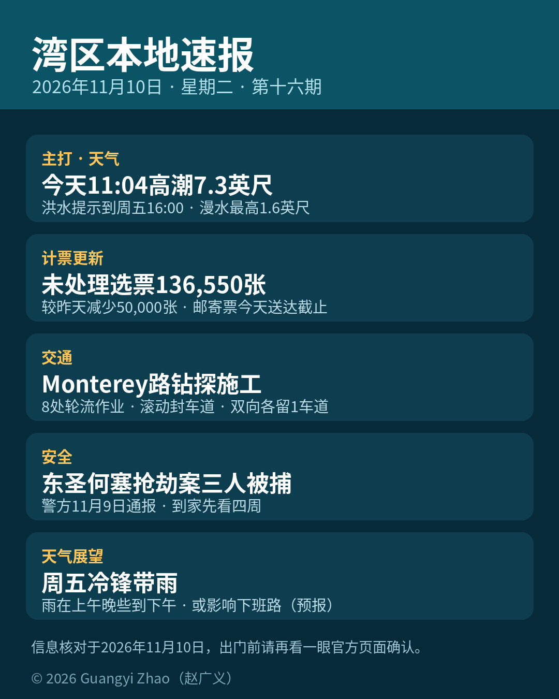

title: 今天11:04高潮，湾岸低洼先防漫水
date: 2026-11-10
series: baylocal
author: Guangyi Zhao
---

《湾区本地速报》第十六期，2026年11月10日，星期二，五条本地新闻：

**主打·天气与安全**：国家气象局（NWS）今天凌晨 0 点 19 分发布的海岸危险通告：旧金山与旧金山湾岸分区的海岸洪水提示持续到 11月13日（周五）下午 4 点，低洼近岸与潮汐水道一带漫水最高可能高出地面 1.6 英尺，可能造成低洼设施被淹、个别道路关闭与海岸侵蚀。今天上午 11 点 04 分，旧金山潮位站高潮预计 7.3 英尺、高出正常 1.5 英尺；明天（11月11日）上午 11 点 35 分还有 7.2 英尺、高出正常 1.4 英尺。半岛海岸等分区的同类提示今天中午结束。官方提醒：不要绕过路障、不要开车穿过深浅不明的积水，出行请预留时间。

**计票更新**：圣塔克拉拉县选务处昨天下午 5 点更新未处理选票估计：全县还没处理完的选票估计 136,550 张，较前一天（11月8日下午 5 点）的 186,550 张减少 50,000 张。其中选举日及之前收到的邮寄票 109,000 张、选举日后收到的 15,650 张、附条件登记票 6,500 张、临时票 400 张，另有 5,000 张卡在签名核验。按加州选举法第 3020 条，邮寄选票只要在选举日当天或之前寄出（以邮戳为准）、选举日后 7 天内送达就必须计入——今天 11月10日就是送达截止日；签名缺失或不符的选民可在选举日后 22 天内提交核验声明。以上均为估计数，结果未经认证。

**交通**：圣何塞谷地交通局（VTA）施工通告：为 US 101 / Monterey Road 野生动物通道项目做前期地质钻探，Monterey Road 的 Metcalf 路至 Blanchard 路段共 8 处地点轮流钻探取数，每处约 2 到 4 小时并恢复路面。工期约从 11月9日起、最长 4 天，工作时间为周一至周四早上 7 点到傍晚 6 点；天气与许可允许时会有间歇性滚动封闭车道，施工点双向各至少保留一条车道通行。走这段路请预留时间。

**安全**：圣何塞警察局 11月9日（周一）发布、KION（CBS Bay Area）转述：今年 8月7日晚约 10 点 30 分，东圣何塞一户三口（两名成人与一名儿童）刚到家把车停在自家车道，两名嫌疑人持械抢走首饰与财物后驾车逃离，是否有人受伤警方未披露。侦探以车牌识别数据锁定车辆与嫌疑人，三名嫌疑人已于 10月22日与 26 日分别在 Stockton、Sacramento 与 Tracy 被捕，均以持械抢劫罪名关入圣塔克拉拉县主监狱。警方请知情者联系抢劫组 Detective Ortega #4834（4834@sanjoseca.gov / 408-277-4166）。

**天气展望**：国家气象局预报讨论：今天和明天（退伍军人日）都是干天，白天最高温沿海 60 多华氏度、内陆 70 多到 80 出头华氏度，夜间低温 40 到 50 多华氏度。本周五冷锋抵达，降雨的可能性上升：目前预计雨量北湾约 1 英寸、其他地区约 1/3 到 1/2 英寸，主要时段更可能在周五上午晚些到下午，可能影响下午与傍晚通勤；周六还有零星阵雨，周日再有冷锋。这是预报口径，临近时请再看官方更新。

来源：[国家气象局海岸危险通告 CFWMTR（2026-11-10 00:19）](https://forecast.weather.gov/product.php?site=BTV&issuedby=MTR&product=CFW&format=ci&version=1&glossary=0) · [国家气象局预报讨论 AFDMTR（2026-11-10 04:16）](https://forecast.weather.gov/product.php?site=PUB&product=AFD&issuedby=MTR) · [圣塔克拉拉县选务处未处理选票估计](https://vote.santaclaracounty.gov/elections/unprocessed-ballot-estimates) · [VTA 施工通告（Monterey Road 钻探）](https://www.vta.org/sites/default/files/2026-11/MontereyRoadWildlifeCrossing-Potholing-11-2026.pdf) · [KION 转述圣何塞警察局通报（东圣何塞抢劫案）](https://kioncentralcoast.com/news/2026/11/09/suspects-from-sacramento-stockton-tracy-arrested-in-armed-robbery-of-san-jose-family/)

数字证据说明：本期五条中四条为 A 级（官方原文：国家气象局通告与预报讨论、县选务处、VTA，核对日期 2026-11-10），安全条为 B 级（可靠媒体转述警方新闻稿）；高潮数值通告正文与预报讨论口径一致（今天 7.3 英尺/+1.5 英尺）；选票数字为选务处估计口径、结果未认证，稿中已注明；周五雨量为预报口径。

*《湾区本地速报》为《代码与诗篇》新闻矩阵第 8 档，每日早上更新。播报版（音频/视频）同日发布于 YouTube「Ezra Daily 每日速报」。© 2026 Guangyi Zhao*
