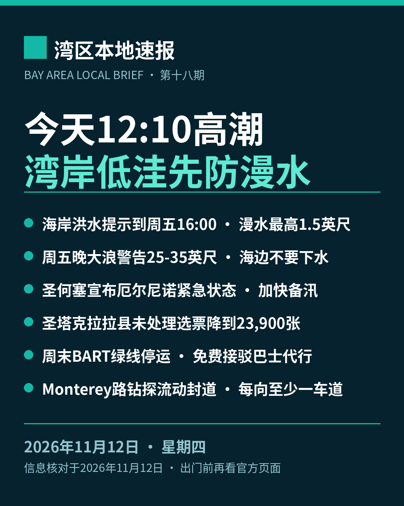

title: 今天12:10高潮，湾岸低洼先防漫水
date: 2026-11-12
series: baylocal
author: Guangyi Zhao
---

《湾区本地速报》第十八期，2026年11月12日，星期四，五条本地新闻：

**主打·天气与安全**：国家气象局（NWS）11月11日晚上 10 点 48 分发布的海岸危险通告：旧金山湾岸分区的海岸洪水提示持续到 11月13日（周五）下午 4 点，低洼近岸与潮汐水道一带漫水最高可能高出地面 1.5 英尺，可能造成低洼设施被淹、个别道路关闭与海岸侵蚀。今天中午 12 点 10 分，旧金山潮位站高潮预计 7.1 英尺、高出正常 1.3 英尺；明天（11月13日）12 点 49 分为 7.3 英尺、高出正常 1.5 英尺，预测含最高 1.8 英尺的涌浪增量。海岸危险提示持续到周五下午（碎浪 15 到 20 英尺、偷袭浪与强离岸流风险上升）；周五傍晚 6 点到周日凌晨 4 点大浪警告，危险大碎浪 25 到 35 英尺，个别有利断点可达 40 到 50 英尺；太平洋海岸周六另有第二轮海岸洪水提示（周五午夜到周六傍晚 6 点）。官方提醒：不要绕过路障、不要开车穿过深浅不明的积水；不要下水，远离防波堤、码头与礁石，永远不要背对大海。

**市政**：圣何塞进入厄尔尼诺本地紧急状态。市议会 11月10日（周二）宣布本地紧急状态，应对预报中可能达历史级的厄尔尼诺风暴季：市府可更快采购防洪物资、签约引入承包商清理河道、向邻市、县与州请求互助，并跨部门调配人力。市应急储备金现可用 550 万美元，花费将寻求州与联邦报销；此举与州长 9月21日的全州紧急状态对齐。紧急状态持续到市议会结束为止，至少每 60 天复核一次，首次复核为 12月15日市议会，其后为 2027年2月9日。市府与谷水局重点监测七条水道：Coyote Creek、Guadalupe River、Canoas Creek、Ross Creek、Upper Penitencia Creek、Berryessa Creek 与 Lower Silver Creek（含 Lake Cunningham）。居民可到 AlertSCC.org 登记紧急警报，并查看市府洪水地图确认自家是否在洪泛区。

**计票更新**：圣塔克拉拉县选务处 11月11日下午 5 点更新未处理选票估计：全县还没处理完的选票估计 23,900 张，较前一天（11月10日下午 5 点）的 67,000 张减少 43,100 张。其中选举日后收到的邮寄票 14,000 张、附条件登记票 6,500 张、临时票 400 张，另有 3,000 张卡在签名核验——按加州选举法第 3020 条，签名缺失或不符的选民可在选举日后 22 天内提交核验声明。县选务处预告今天（11月12日）下午 5 点前还有一次结果更新。以上均为估计数，结果未经认证。

**交通**：BART 官方通告：为安装新列车控制系统（CBTC），本周六、周日（11月14、15日）24th Street Mission 站至 Daly City 站之间没有列车，绿线整个周末停运，正常服务周一早上 5 点恢复。免费接驳巴士代行：SamTrans 快线在两端之间直达，Muni 跳站巴士同区间并停 Glen Park 与 Balboa Park 两站（两站无列车）。红线只跑 Richmond 至 24 街，蓝线只跑 Dublin 至 24 街，Daly City 至 Millbrae 每 15 分钟一班，其他线 20 分钟一班，全线发车时刻最多提前或推后 3 分钟，24 街以南出行延误可达 30 分钟。南湾乘客去旧金山可乘橙线到 Bay Fair 换蓝线；周六早上 5 点 40 分、周日早上 7 点 40 分各有一班额外橙线车从 Berryessa 发车。停车提醒：Daly City 站 St Charles Avenue 地面停车场周五晚上 8 点起关闭、周一凌晨 4 点前重开，John Daly Boulevard 与 De Long Street 停车场 11月14、15日全天关闭。

**道路**：VTA 施工通告（US 101/Monterey Road 野生动物通道项目）：Monterey Road 圣何塞段、Metcalf Road 与 Blanchard Road 之间，为设计收集地质数据，有临时、间歇、流动式车道封闭做钻探，每处约 2 到 4 小时并恢复路面。开始日期约为 11月9日，最多 4 天查 8 处，工作时间为周一至周四早上 7 点到傍晚 6 点；施工处每个方向始终至少保留一条车道通行。按开始日与周一至周四的口径推算，11月12日是这批钻探的最晚一天，经过这一带请预留时间。

来源：[国家气象局海岸危险通告 CFWMTR（2026-11-11 22:48）](https://marine.weather.gov/product.php?site=GYX&product=CFW&issuedby=MTR) · [South Bay Chronicle：圣何塞厄尔尼诺紧急状态（2026-11-12，引市府 11-10 新闻稿）](https://southbaychronicle.com/2026/11/12/san-jose-local-emergency-el-nino-proclaimed-what-it-means-creek-hot-spots/) · [圣塔克拉拉县选务处未处理选票估计](https://vote.santaclaracounty.gov/elections/unprocessed-ballot-estimates) · [BART 周末停运与接驳通告](https://www.bart.gov/news/articles/2026/news20261015) · [VTA Monterey Road 钻探施工通告（PDF）](https://www.vta.org/sites/default/files/2026-11/MontereyRoadWildlifeCrossing-Potholing-11-2026.pdf)

数字证据说明：本期五条中四条为 A 级（官方原文：国家气象局通告、县选务处、BART、VTA，核对日期 2026-11-12），市政条为 B 级（本地媒体引市府新闻稿与备忘录，市府原文未直接打开，数字封顶 B）；高潮数值以通告正文为准（今天 7.1 英尺/+1.3 英尺）；选票数字为选务处估计口径、结果未认证，减少数 43,100 张为两日估计数之差；大浪警告为预报口径；Monterey Road 钻探的最晚一天为按通告口径的推算，稿中已注明推算口径。

*《湾区本地速报》为《代码与诗篇》新闻矩阵第 8 档，每日早上更新。播报版（音频/视频）同日发布于 YouTube「Ezra Daily 每日速报」。© 2026 Guangyi Zhao*
