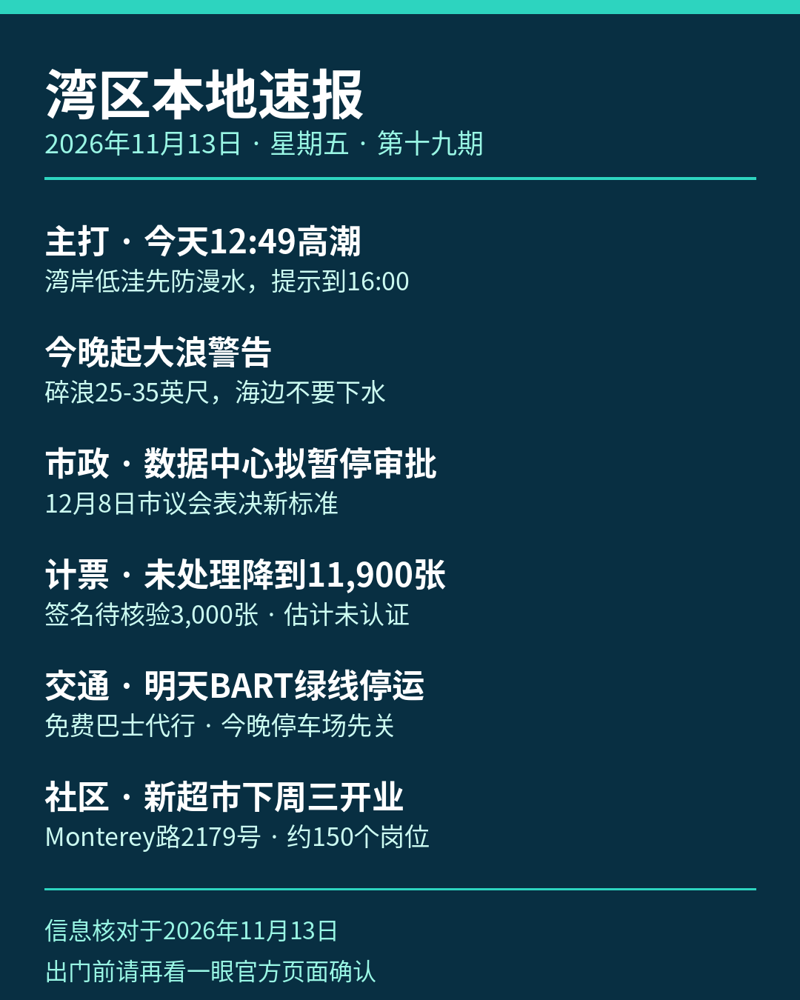

《湾区本地速报》第十九期，2026年11月13日，星期五，五条本地新闻：

**主打·天气与安全**：国家气象局（NWS）海岸危险通告（2026-11-12 下午 2 点 58 分发出、11月13日凌晨 3 点 44 分更新）：旧金山湾岸分区的海岸洪水提示持续到今天（11月13日）下午 4 点，低洼近岸与潮汐水道一带漫水最高可能高出地面 1.5 英尺，可能造成低洼设施被淹、个别道路关闭与海岸侵蚀。今天中午 12 点 49 分，旧金山潮位站高潮预计 7.3 英尺、高出正常 1.5 英尺，是这一轮最高的一天，预测含最高 1.8 英尺的涌浪增量，高潮时间沿太平洋海岸与湾内可早晚达 90 分钟。海岸危险提示持续到今天下午（碎浪 15 到 20 英尺、偷袭浪与强离岸流风险上升）；今晚 6 点到周日凌晨 4 点大浪警告，危险大碎浪 25 到 35 英尺，个别有利断点可达 40 到 50 英尺；太平洋海岸周六另有第二轮海岸洪水提示（今晚午夜到周六傍晚 6 点，大浪越过海堤漫上邻近低洼设施）。官方提醒：不要绕过路障、不要开车穿过深浅不明的积水；不要下水，远离防波堤、码头与礁石，永远不要背对大海。

**市政**：圣何塞拟暂停数据中心审批。市长 Matt Mahan 与市议员 Pamela Campos、David Cohen、Peter Ortiz、Domingo Candelas 11月12日提出，暂停数据中心土地使用审批，防止项目在新标准通过前抢先获批。规划委员会 11月18日先审议最新版标准，市议会拟 12月8日表决统一标准。拟议标准包括全部使用清洁电力、闭环用水等要求（多源表述略有差异，本期只取多源一致的两项）。官员上月称，圣何塞审查中的数据中心申请有 11 件。此条为提案与拟议口径，尚未表决通过。

**计票更新**：圣塔克拉拉县选务处 11月12日下午 5 点更新未处理选票估计：全县还没处理完的选票估计 11,900 张，较前一天（11月11日下午 5 点）的 23,900 张减少 12,000 张。其中选举日后收到的邮寄票 2,000 张、附条件登记票 6,500 张、临时票 400 张，另有 3,000 张卡在签名核验——按加州选举法第 3020 条，签名缺失或不符的选民可在选举日后 22 天内提交核验声明。以上均为估计数，结果未经认证。

**交通**：BART 官方通告：为安装新列车控制系统（CBTC），明天、后天（11月14、15日）24th Street Mission 站至 Daly City 站之间没有列车，绿线整个周末停运，正常服务周一早上 5 点恢复。免费接驳巴士代行：SamTrans 快线在两端之间直达，Muni 跳站巴士同区间并停 Glen Park 与 Balboa Park 两站（两站无列车）。红线只跑 Richmond 至 24 街，蓝线只跑 Dublin 至 24 街，Daly City 至 Millbrae 每 15 分钟一班，其他线 20 分钟一班，全线发车时刻最多提前或推后 3 分钟，24 街以南出行延误可达 30 分钟。南湾乘客去旧金山可乘橙线到 Bay Fair 换蓝线；周六早上 5 点 40 分、周日早上 7 点 40 分各有一班额外橙线车从 Berryessa 发车。停车提醒：Daly City 站 St Charles Avenue 地面停车场今晚（11月13日）晚上 8 点起关闭、周一凌晨 4 点前重开，John Daly Boulevard 与 De Long Street 停车场 11月14、15日全天关闭。

**社区**：南加州家族连锁超市 Vallarta 湾区第一家店，下周三（11月18日）在圣何塞 Monterey Road 2179 号的 The Plant 购物中心开业，举行剪彩与开业庆祝。店面约 63,000 平方英尺（公司稿口径，部分媒体作 64,000），新增约 150 个岗位，开业后该连锁在加州与亚利桑那共 67 家店；该铺位自 2018 年以来空置。本期只报开业事件本身，不展开开业赠品领取方式。

来源：[国家气象局旧金山湾岸海岸洪水提示（NWS MTR）](https://forecast.weather.gov/showsigwx.php?warnzone=CAZ506&warncounty=CAC041&firewxzone=CAZ506&local_place1=Mill+Valley+CA&product1=Coastal+Flood+Advisory) · [San José Spotlight：圣何塞拟暂停数据中心审批（2026-11-12）](https://sanjosespotlight.com/?p=243177) · [圣塔克拉拉县选务处未处理选票估计](https://vote.santaclaracounty.gov/elections/unprocessed-ballot-estimates) · [BART 周末停运与接驳通告](https://www.bart.gov/news/articles/2026/news20261015) · [Vallarta 超市湾区首店公司新闻稿（PR Newswire，2026-11-12）](https://www.prnewswire.com/news-releases/vallarta-supermarkets-brings-its-authentic-latin-grocery-experience-to-bay-area-with-first-san-jose-store-302937740.html)

数字证据说明：本期五条中三条为 A 级（官方原文：国家气象局通告、县选务处、BART，核对日期 2026-11-13），市政与社区两条为 B 级（本地媒体与公司新闻稿多源交叉，数字封顶 B）；高潮数值以通告正文为准（今天 7.3 英尺/+1.5 英尺）；选票数字为选务处估计口径、结果未认证，减少数 12,000 张为两日估计数之差；大浪警告与数据中心标准均为预报/拟议口径。

*《湾区本地速报》为《代码与诗篇》新闻矩阵第 8 档，每日早上更新。播报版（音频/视频）同日发布于 YouTube「Ezra Daily 每日速报」。© 2026 Guangyi Zhao*
