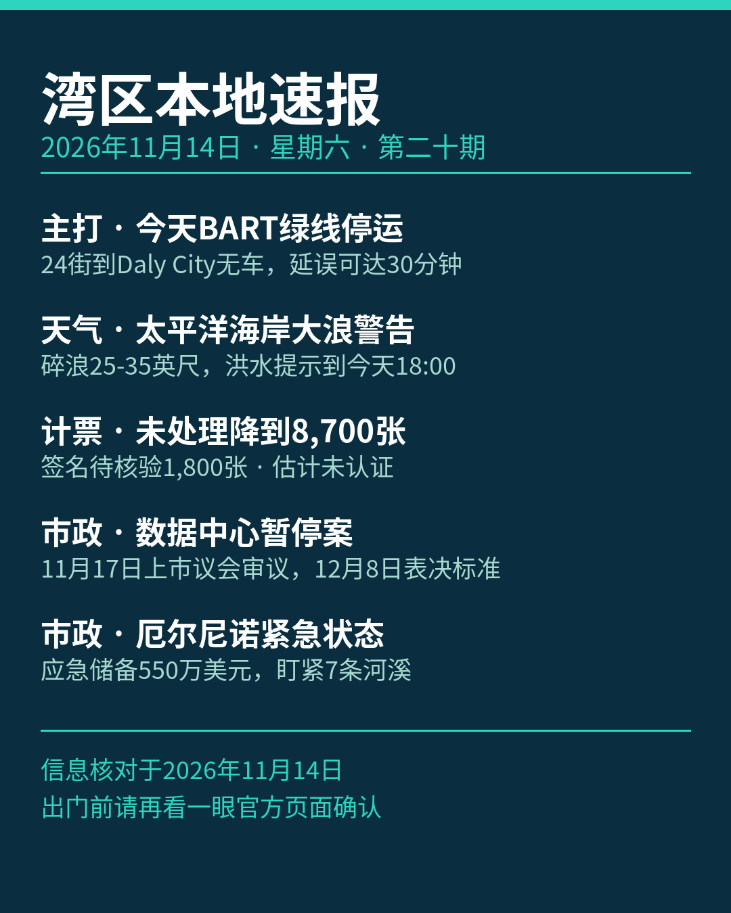

《湾区本地速报》第二十期，2026年11月14日，星期六，五条本地新闻：

**主打·交通**：BART 官方通告（2026年11月3日更新）：为安装新列车控制系统（CBTC），今天、明天（11月14、15日）24th Street Mission 站至 Daly City 站之间没有列车，绿线整个周末停运。免费接驳巴士代行：SamTrans 快线在两端之间直达，Muni 跳站巴士同区间并停 Glen Park 与 Balboa Park 两站（两站无列车、由巴士服务）。红线只跑 Richmond 至 24 街，蓝线只跑 Dublin 至 24 街，Daly City 至 Millbrae 每 15 分钟一班，其他线 20 分钟一班，全线发车时刻最多提前或推后 3 分钟，24 街以南出行延误可达 30 分钟。今早 5 点 40 分、明早 7 点 40 分各有一班额外橙线车从 Berryessa 发车，替代被取消的首班绿线。停车提醒：Daly City 站 St Charles Avenue 地面停车场昨晚 8 点起已关闭、周一凌晨 4 点前重开，John Daly Boulevard 与 De Long Street 停车场 11月14、15日全天关闭。

**天气与安全**：国家气象局（NWS）海岸危险通告（2026年11月14日凌晨 1 点 05 分发出）：太平洋海岸大浪警告持续到明天（11月15日）凌晨 4 点，危险大碎浪 25 到 35 英尺，个别有利断点可达 40 到 50 英尺；太平洋海岸洪水提示持续到今天傍晚 6 点，大浪会越过海堤、漫上邻近低洼设施，可能造成低洼设施被淹、个别道路关闭与海岸侵蚀。官方提醒：不要下水，远离防波堤、码头与礁石，永远不要背对大海。另说明：前几日持续的旧金山湾岸洪水提示已经结束，湾岸分区今天没有生效中的洪水通告，本期不报湾岸漫水。

**计票更新**：圣塔克拉拉县选务处 11月13日下午 4 点更新未处理选票估计：全县还没处理完的选票估计 8,700 张，较前一天（11月12日下午 5 点）的 11,900 张减少 3,200 张。其中附条件登记票 6,500 张、临时票 400 张，另有 1,800 张卡在签名核验——按加州选举法第 3020 条，签名缺失或不符的选民可在选举日后 22 天内提交核验声明。以上均为估计数，结果未经认证。

**市政**：圣何塞数据中心审批暂停案有新节点。市长与 4 位议员 11月12日提出的暂停案本身，定于下周二（11月17日）先上市议会审议；规划委员会 11月18日审议拟议开发标准，市议会 12月8日表决标准。暂停案与配套紧急条例均尚未通过，属提案口径，后续节点以市府正式议程为准。

**市政**：圣何塞进入厄尔尼诺本地紧急状态。市议会 11月10日宣布本地紧急状态，应对冬季风暴与洪水风险；市应急储备基金现有 550 万美元可用于风暴支出。市府与 Valley Water 盯紧 7 条水道的易涝点：Coyote Creek、Guadalupe River、Canoas Creek、Ross Creek、Upper Penitencia Creek、Berryessa Creek 与 Lower Silver Creek（含 Lake Cunningham）。紧急状态与州长 9月21日的州紧急状态对齐，市议会将定期复审，首次复审在 12月15日。

来源：[BART 周末停运与接驳通告](https://www.bart.gov/news/articles/2026/news20261015) · [国家气象局太平洋海岸洪水提示（NWS MTR）](https://forecast.weather.gov/showsigwx.php?warnzone=CAZ006&warncounty=CAC075&firewxzone=CAZ006&local_place1=San%20Francisco%20CA&product1=Coastal+Flood+Advisory) · [圣塔克拉拉县选务处未处理选票估计](https://vote.santaclaracounty.gov/elections/unprocessed-ballot-estimates) · [heyday.news：圣何塞拟暂停数据中心审批（2026-11-13）](https://heyday.news/articles/san-jose-data-center-approval-pause-new-rules-8e5999f8) · [South Bay Chronicle：圣何塞厄尔尼诺本地紧急状态（2026-11-12）](https://southbaychronicle.com/2026/11/12/san-jose-local-emergency-el-nino-proclaimed-what-it-means-creek-hot-spots/)

数字证据说明：本期五条中三条为 A 级（官方原文：BART、国家气象局通告、县选务处，核对日期 2026-11-14），市政两条为 B 级（本地媒体多源交叉、市府原文未直接打开，数字封顶 B）；选票数字为选务处估计口径、结果未认证，减少数 3,200 张为两日估计数之差；大浪警告为预报口径、数据中心暂停案为提案口径，均未写成既成事实。

*《湾区本地速报》为《代码与诗篇》新闻矩阵第 8 档，每日早上更新。播报版（音频/视频）同日发布于 YouTube「Ezra Daily 每日速报」。© 2026 Guangyi Zhao*
