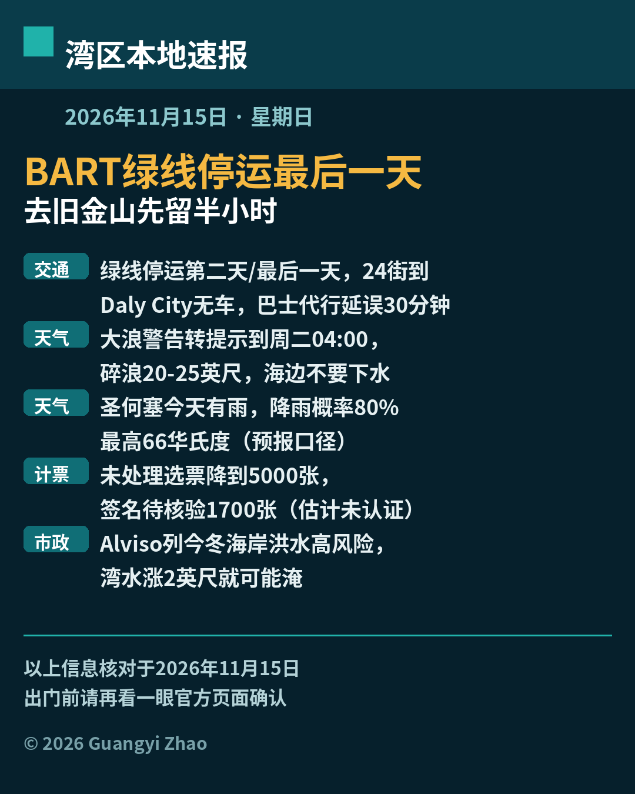

《湾区本地速报》第二十一期，2026年11月15日，星期日，五条本地新闻：

**主打·交通**：BART 官方通告（2026年11月3日更新）：为安装新列车控制系统（CBTC），今天是 24th Street Mission 站至 Daly City 站之间无列车、绿线停运的第二天，也是最后一天。免费接驳巴士代行：SamTrans 快线在两端之间直达，Muni 跳站巴士同区间并停 Glen Park 与 Balboa Park 两站（两站无列车、由巴士服务）。红线只跑 Richmond 至 24 街，蓝线只跑 Dublin 至 24 街，Daly City 至 Millbrae 每 15 分钟一班，其他线 20 分钟一班，24 街以南出行延误可达 30 分钟。今早 7 点 40 分有一班额外橙线车从 Berryessa 发车，替代被取消的首班绿线。停车提醒：Daly City 站两个地面停车场今天（11月15日）全天关闭。列车明天恢复正常（据汇总 BART/SFMTA 口径的转述：常规服务周一凌晨 5 点恢复）。

**天气与安全**：国家气象局（NWS）海岸危险通告（2026年11月15日凌晨 3 点 43 分更新）：太平洋海岸大浪警告今晨 4 点到期结束，转为大浪提示，一直持续到下周二（11月17日）凌晨 4 点。碎浪 20 到 25 英尺，个别有利断点 25 到 35 英尺；高潮时可能有低洼设施被淹、个别道路关闭与海岸侵蚀。官方提醒：不要下水，远离防波堤、码头与礁石，永远不要背对大海。

**天气**：国家气象局分区预报表（2026年11月15日凌晨 5 点 01 分发出）：圣何塞今天白天主导天气为雨，白天降雨概率 80%，最高气温 66 华氏度。此为预报口径，出门带伞，开车注意路面积水。

**计票更新**：圣塔克拉拉县选务处 11月14日下午 5 点更新未处理选票估计：全县还没处理完的选票估计 5,000 张，较前一天（11月13日下午 4 点）的 8,700 张减少 3,700 张。其中附条件登记票 3,000 张、临时票 300 张，另有 1,700 张卡在签名核验——按加州选举法第 3020 条，签名缺失或不符的选民可在选举日后 22 天内提交核验声明。以上均为估计数，结果未经认证。

**市政**：圣何塞洪水风险新报告。San José Spotlight 11月13日报道：加州大学戴维斯分校道路生态中心的一份报告把圣何塞北部社区 Alviso 列入加州今冬海岸洪水高风险社区名单，称厄尔尼诺叠加海平面上升可使湾南端沼泽漫溢；Alviso 地势低于海平面，西临 Guadalupe River、东临 Coyote Creek，湾水上涨 2 英尺即可发生洪水。圣何塞全市有 140 英里水道穿城。沿岸居民提前备好应急用品。

来源：[BART 周末停运与接驳通告](https://www.bart.gov/news/articles/2026/news20261015) · [国家气象局海岸危险通告（NWS MTR）](https://forecast.weather.gov/product.php?site=SEW&product=CFW&issuedby=MTR) · [国家气象局分区预报表（NWS MTR）](https://forecast.weather.gov/product.php?site=BOI&product=SFT&issuedby=MTR) · [圣塔克拉拉县选务处未处理选票估计](https://vote.santaclaracounty.gov/elections/unprocessed-ballot-estimates) · [San José Spotlight：圣何塞冬季洪水风险（2026-11-13）](https://sanjosespotlight.com/?p=243150)

数字证据说明：本期五条中四条为 A 级（官方原文：BART、国家气象局通告与预报表、县选务处，核对日期 2026-11-15），市政一条为 B 级（本地媒体引 UC Davis 报告，关键数字未经一手报告原文终核、封顶 B）；选票数字为选务处估计口径、结果未认证，减少数 3,700 张为两日估计数之差；降雨与大浪均为预报/通告口径；「明天恢复正常」为汇总 BART/SFMTA 口径的 B 级转述，已在文中标注。

*《湾区本地速报》为《代码与诗篇》新闻矩阵第 8 档，每日早上更新。播报版（音频/视频）同日发布于 YouTube「Ezra Daily 每日速报」。© 2026 Guangyi Zhao*
