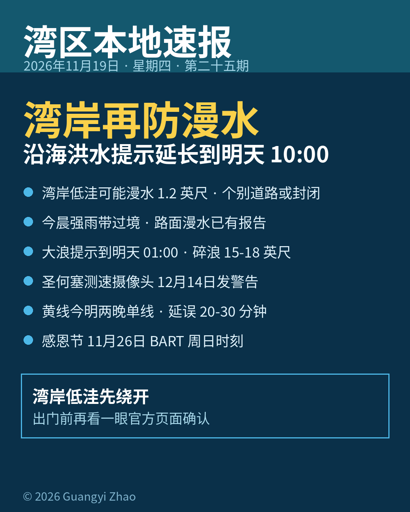

《湾区本地速报》第二十五期，2026年11月19日，星期四，六条本地新闻：

**主打·天气**：国家气象局旧金山湾区沿海洪水提示今晨（11月19日）05:55 重新发布，持续到明天（11月20日）10:00。湾岸低洼近岸与潮汐水道一带可能出现最高 1.2 英尺漫水，低洼设施可能被淹、个别道路可能临时封闭，并有海岸侵蚀风险；旧金山潮位站今晨 07:15 高潮 7.0 英尺（高于正常 1.2 英尺），明天 07:45 高潮 6.9 英尺。气象局今晨 04:39 预报讨论指出，强雨带正过境湾区与中央海岸，多地洪水提示生效，路面漫水已有报告，土壤已饱和、影响加重。今晨开车不要开进积水路段。

**天气与安全**：同为气象局提示：大浪提示持续到明天（11月20日）01:00，太平洋沿岸碎浪 15 到 18 英尺，巨浪可能把人卷入海中。官方提醒：不要下水，也不要站在礁石与防波堤上看浪。（注：部分镜像站把大浪提示结束时间写为 04:00，本稿以气象局 API 原文 01:00 为准。）

**市政**：圣何塞测速安全摄像头试点：市府官方页确认，全市最多 33 套摄像头，多数点位 12 月 14 日起对超限速至少 11 英里/小时的车主发警告通知；2027 年初、各点位启用满 60 天后开始开违规通知（罚单），罚款 50 到 500 美元。Verra Mobility 今日（11月19日）新闻稿称，市府已批准其设计、建设、运营与维护合同，先上 6 处，点位都在高伤亡、高车速路段，分阶段实施。

**交通**：BART 官方通告：黄线钢轨去应力施工，今晚起连着两晚（11月19日至20日）深夜在 Lafayette 至 Walnut Creek 之间把双线减为单线，午夜开始、持续到次日运营开始前，延误 20 到 30 分钟。今晚与明晚深夜坐黄线，先查时刻表再出门。

**社区**：BART 昨天（11月18日）宣布，盲人与低视力乘客的 Aira 视频讲解试点延长到 2027 年 4 月 3 日（原至 1 月 3 日）。12 个车站（16th St/Mission、24th St/Mission、Embarcadero、Civic Center、Powell、12th St Oakland、19th St Oakland、Ashby、El Cerrito del Norte、Fremont、Hayward、Downtown Berkeley）进站自动启用免费额度；试点期间全线乘车相关通话免费、无地域限制、24 小时可用，讲解员可读标牌、帮找闸机与站台。

**交通预告**：BART 官方感恩节通告：11 月 26 日感恩节按周日时刻运行，08:00 至 24:00，五条线开到 21:00、之后三条线；车站停车当天免费，Milpitas 与 Berryessa/North San Jose 两站除外（VTA 运营）；11 月 27 日恢复平日时刻。另据 Stanford Transportation 汇总：11 月 26 日 Caltrain 走周末时刻，VTA 走周日/假日时刻。

来源：[国家气象局实时警报（api.weather.gov，旧金山点位）](https://api.weather.gov/alerts/active?point=37.7749,-122.4194) · [圣何塞市政府测速安全摄像头试点官方页](https://www.sanjoseca.gov/your-government/departments-offices/transportation/projects/speed-cameras-project) · [BART 黄线钢轨施工单线通告](https://www.Bart.Gov/news/articles/2025/news20250326-1) · [BART Aira 视频讲解试点延长通告（2026-11-18 更新）](https://www.bart.gov/news/articles/2026/news20261006) · [BART 感恩节周日时刻通告](https://www.bart.gov/news/articles/2026/news20261113-0)

数字证据说明：本期六条中沿海洪水/大浪、黄线单线、Aira 延长、感恩节 BART 时刻为 A 级（气象局与 BART 官方原文，核对日期 2026-11-19）；今晨雨带与潮位为 A/B 级（气象局预报讨论与提示原文经镜像核对）；圣何塞测速摄像头为 A/B 级（市府官方页 A 级＋运营商新闻稿 B 级）；Caltrain/VTA 感恩节时刻为 B 级（Stanford Transportation 汇总）。所有漫水、碎浪与高潮数字均为通告/预报口径。

*《湾区本地速报》为《代码与诗篇》新闻矩阵第 8 档，每日早上更新。播报版（音频/视频）同日发布于 YouTube「Ezra Daily 每日速报」。© 2026 Guangyi Zhao*
