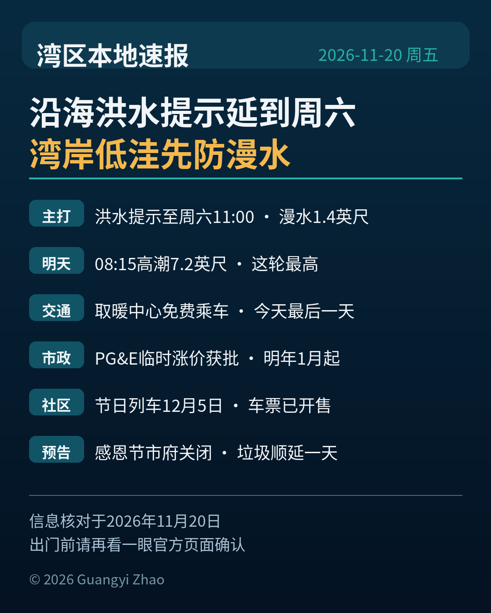

《湾区本地速报》第二十六期，2026年11月20日，星期五，六条本地新闻：

**主打·天气**：国家气象局旧金山湾区沿海洪水提示今天（11月20日）03:41 更新，持续到明天（11月21日，周六）11:00。湾岸低洼近岸与潮汐水道一带可能出现最高 1.4 英尺漫水，低洼设施可能被淹、个别道路可能临时封闭，并有海岸侵蚀风险；旧金山潮位站今天 07:45 高潮 6.9 英尺（高于正常 1.1 英尺），明天 08:15 高潮 7.2 英尺（高于正常 1.4 英尺），预测含最高 1.8 英尺风浪增水。气象局预告：周日太平洋沿岸可能加入提示范围，临近大潮日（King Tides），旧金山湾与圣巴勃罗湾的提示可能升级为沿海洪水警告（预告口径）。大浪提示已于今晨 04:00 到期。

**交通与安全**：VTA 官方通告：因预计恶劣天气，11月18日至20日往返圣克拉拉县取暖中心的公交与轻轨免费乘坐，今天（11月20日）是最后一天，至 23:59；上车告知司机即可、无需证明。圣克拉拉县应急管理办公室：圣何塞各图书馆与部分社区中心在营业时间内可作取暖中心，最近的点可在县应急管理办公室页面查询。

**市政与公用事业**：加州公用事业委员会昨天（11月19日）全票（5-0）批准 PG&E 临时费率回收，最高 4.56 亿美元，2027 年 1 月 1 日起执行、至费率案最终裁定为止；电价大约涨 3%，燃气降价部分抵消；多收的部分在终裁后带利息退还给用户。新闻报道所称「平均账单约多 6 美元」未见于决定原文的典型账单估算，本稿不采用。

**市政**：圣克拉拉市批准英伟达总部第四期（The Registry 2026-11-20 报道）：在 Walsh 大道拆掉 12 栋老工业楼，建一栋三层、692,634 平方英尺的办公楼；听证会上工会与承包商到场支持。

**社区**：Caltrain 官方通告：节日列车 12 月 5 日开行，车票已于 11 月 18 日中午开售。南行旧金山 16:20 发车、经 Millbrae、San Mateo、Palo Alto、Santa Clara，17:19 到圣何塞；北行圣何塞 18:11 发车、19:25 到旧金山。装饰列车今年首次在特别班次之后继续运营到 12 月 13 日。票价各源不一致，本稿不报票价，请以 Caltrain 官方售票页为准。

**市政预告**：圣何塞市政府官方安排：市政府与各办公室 11 月 26 日（感恩节）与 27 日关闭，公共安全与公用事业照常运行；垃圾、回收与庭院垃圾感恩节当天不收，收集日在感恩节当天或之后的一律顺延一天；图书馆全部分馆两天关闭；311 关闭，由应答服务代接。要办事的请提前安排。

来源：[国家气象局海岸危险通告（forecast.weather.gov，2026-11-20 03:41）](https://forecast.weather.gov/wwamap/wwatxtget.php?cwa=mtr&wwa=coastal+flood+advisory) · [VTA 取暖中心免费乘车通告](https://www.vta.org/blog/free-vta-bus-and-light-rail-service-warming-centers) · [Consumer Watchdog 就 CPUC 批准 PG&E 临时费率的声明（2026-11-19）](https://www.consumerwatchdog.org/energy/newsoms-cpuc-appointees-approve-456-million-pge-rate-hike-before-becerra-takes-office-despite-unanswered-questions-about-2-billion-in-spending-cuts/) · [The Registry：圣克拉拉批准英伟达总部第四期（2026-11-20）](https://news.theregistrysf.com/santa-clara-approves-nvidias-693000-sqft-walsh-avenue-office-building-the-fourth-phase-of-its-headquarters-campus/) · [Caltrain 节日列车官方通告](https://www.caltrain.com/news/all-aboard-holiday-train-saturday-dec-5) · [圣何塞市政府 City Manager's Monthly Connect（2026-11-04）](https://www.sanjoseca.gov/Home/Components/News/News/7648/)

数字证据说明：本期六条中沿海洪水提示、VTA 取暖乘车、节日列车、感恩节市政安排为 A 级（气象局、VTA、Caltrain、市府官方原文，核对日期 2026-11-20）；PG&E 临时费率与英伟达四期为 B 级（多源交叉一致的媒体报道，未打开监管决定与市府议程原文终核）。所有漫水与高潮数字均为通告/预报口径；提示升级为警告系气象局预告口径。

*《湾区本地速报》为《代码与诗篇》新闻矩阵第 8 档，每日早上更新。播报版（音频/视频）同日发布于 YouTube「Ezra Daily 每日速报」。© 2026 Guangyi Zhao*
