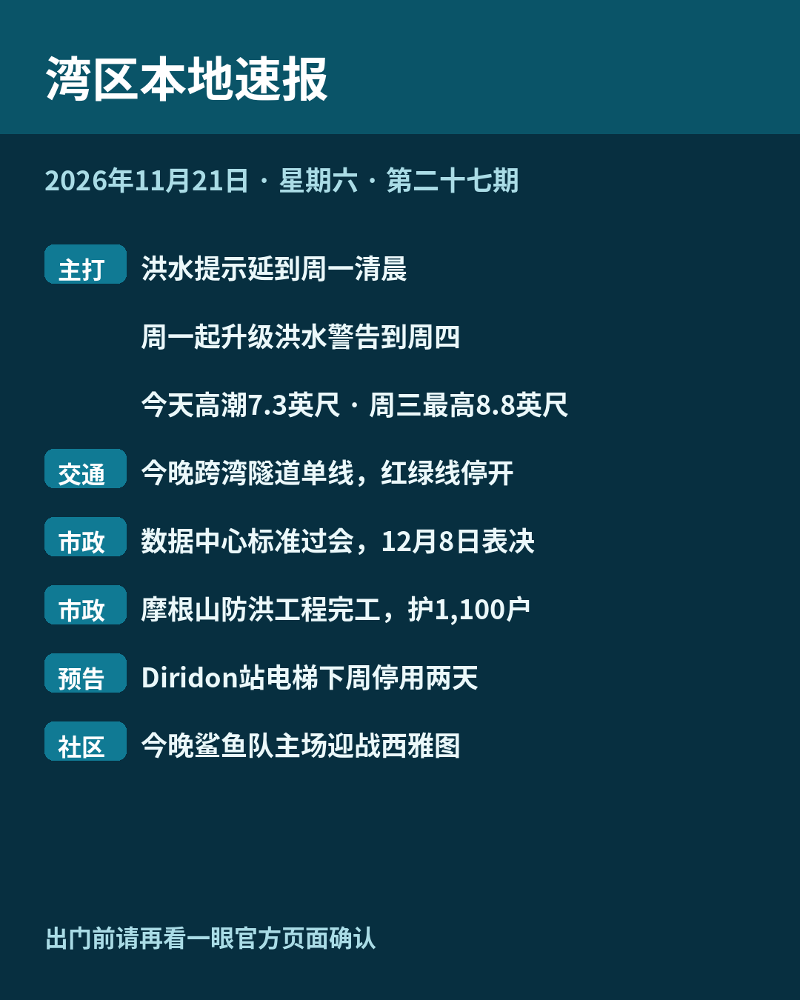

《湾区本地速报》第二十七期，2026年11月21日，星期六，六条本地新闻：

**主打·天气**：国家气象局旧金山湾区海岸危险通告昨天下午（11月20日 14:52）更新：旧金山湾与圣巴勃罗湾岸线的沿海洪水提示延长到周一（11月23日）清晨 06:00，低洼近岸一带漫水最高 2.1 英尺；周一 06:00 起升级为**沿海洪水警告**，持续到周四（11月26日）16:00，漫水最高 3.0 英尺，低洼设施可能被淹、道路可能多处封闭，并有海岸侵蚀。旧金山潮位站高潮逐日升高：今天（周六）08:15 为 7.3 英尺、周日 08:48 为 7.9 英尺、周一 09:25 为 8.1 英尺、周二 10:05 为 8.7 英尺、周三 10:49 最高 8.8 英尺、周四 11:38 为 8.4 英尺，预测含最高 1.8 英尺增水。气象局提醒：不要绕过路障、不要开车穿过水深不明的路段。与昨日通告（提示至周六 11:00、漫水 1.4 英尺）相比，这是升级后的新通告。

**交通**：BART 官方通告：跨湾海底隧道今晚（11月21日）22:00 起更换照明灯，至当晚服务结束改走单线，全线 30 分钟一班，只开蓝线、黄线、橙线，红线与绿线今晚停开；黄线另有机场（SFO）至 Millbrae 接驳车。今晚是本线 11 月 18 日期预告过的执行夜，夜里跨湾出门请先查时刻表。

**市政**：圣何塞规划委员会周三（11月18日）晚全票通过，建议市议会采纳数据中心建设标准，并建议大型数据中心项目的审批权由规划局长改归规划委员会。标准要求全部使用可再生能源、冷却使用再生水而不用饮用水，并含降噪与现行工资等要求。市议会 12 月 8 日表决，通过后按紧急条例可立即生效。（San José Spotlight 2026-11-21 报道）

**市政·防洪**：摩根山 Upper Llagas Creek 防洪工程完工：13.9 英里河道贯通摩根山、圣马丁与吉尔罗伊，保护约 1,100 户住宅、500 家商户与 1,300 多英亩农田，可抵御百年一遇洪水；工程总价 3.95 亿美元，本周一举行剪彩，赶在今年冬季风暴季之前投入使用，植被恢复期至明年春季收尾。（San José Spotlight 2026-11-20 报道）

**交通预告**：Caltrain 官方：圣何塞 Diridon 站电梯 11 月 23 日与 24 日因施工停用，需要无障碍出行的乘客请提前安排；圣马特奥站电梯目前也因技术故障停用，恢复时间未定，出门前请先看车站通告。

**社区**：今晚 19:00，圣何塞鲨鱼队在 SAP Center 主场迎战西雅图海怪队，今晚是动漫主题之夜（Anime Night）；球馆周边晚间车流会增多，去市中心看演出、吃饭的请提前出门。

来源：[国家气象局海岸危险通告（forecast.weather.gov，2026-11-20 14:52）](https://forecast.weather.gov/wwamap/wwatxtget.php?cwa=mtr&wwa=coastal+flood+advisory) · [BART 跨湾隧道单线通告转述（SF News Today，引 BART 官方通告）](https://sfnewstoday.com/news/bart-transbay-tube-november-21-2026-30-minute-trains/) · [San José Spotlight：规划委员会建议数据中心标准（2026-11-21）](https://sanjosespotlight.com/?p=243677) · [San José Spotlight：南县防洪工程完工（2026-11-20）](https://sanjosespotlight.com/?p=243542) · [Caltrain 官方时刻与无障碍通告](https://www.caltrain.com/schedules/pdfs?active_tab=route_explorer_tab&origin=7006&destination=7016&service=weekend)

数字证据说明：本期六条中沿海洪水通告、Caltrain 电梯为 A 级（气象局、Caltrain 官方原文，核对日期 2026-11-21）；BART 今晚单线为 A/B 级（BART 官方通告，本线 11-18 期已按官方原文预告，今晨以官网新闻列表与转述交叉核对）；数据中心标准、防洪工程、鲨鱼队场次为 B 级（可靠本地媒体与多源一致）。所有漫水与高潮数字均为通告预报口径。

*《湾区本地速报》为《代码与诗篇》新闻矩阵第 8 档，每日早上更新。播报版（音频/视频）同日发布于 YouTube「Ezra Daily 每日速报」。© 2026 Guangyi Zhao*
