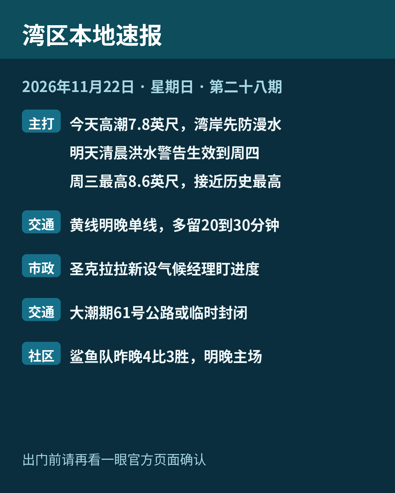

《湾区本地速报》第二十八期，2026年11月22日，星期日，五条本地新闻：

**主打·天气**：国家气象局旧金山湾区海岸危险通告昨天下午（11月21日 14:30）更新：旧金山湾与圣巴勃罗湾岸线的沿海洪水提示持续到周一（11月23日）06:00，低洼近岸一带漫水最高 2.0 英尺；周一 06:00 起**沿海洪水警告**生效，持续到周四（11月26日）16:00，漫水最高 2.8 英尺，低洼设施可能被淹、道路可能多处封闭，并有海岸侵蚀。旧金山潮位站高潮逐日升高：今天（周日）08:48 为 7.8 英尺、周一 09:25 为 8.0 英尺、周二 10:05 为 8.4 英尺、周三 10:49 最高 8.6 英尺、周四 11:38 为 8.2 英尺（MLLW），预测含最高 1.6 英尺增水，气象局称已接近有记录以来的最高潮位。提醒：不要绕过路障、不要开车穿过水深不明的路段。本期数字以周六新通告为准，与昨日所用周五通告（漫水 2.1/3.0 英尺）不同。

**交通预告**：BART 黄线铁路去应力施工下一工作夜为明天（11月23日）夜里，午夜起在 Lafayette 至 Walnut Creek 区间改走单线，一直持续到次日服务开始，夜班乘客请多留 20 到 30 分钟。

**市政**：圣克拉拉市议会 11 月 10 日全票通过（3 人缺席），新设一名全职可持续发展经理，统筹全市气候行动计划进度；岗位年薪区间 179,176 至 244,236 美元，含福利年成本约 31.5 万美元。该市 2022 年气候行动计划目标为 2030 年减排 40%、2035 年 80%、2045 年碳中和；新一轮温室气体清单预计 2027 年 2 月完成。（San José Spotlight 2026-11-21 报道）

**交通提醒**：今天起至 11 月 28 日为 King Tide 大潮期，Caltrans 提醒阿拉米达一带 SR-61 Doolittle Drive 与 Webster、Posey 两条隧道可能因高潮临时封闭；官方未预先排定封闭时间，将视潮位经 QuickMap 等渠道临时通告，要走那一带请先看实时路况。

**社区**：昨晚（11月21日）圣何塞鲨鱼队在 SAP Center 以 4 比 3 击败西雅图海怪队；下一场主场是明天（11月23日）晚上，迎战明尼苏达野人队，去市中心看球请提前出门。

来源：[国家气象局海岸危险通告（forecast.weather.gov，2026-11-21 14:30）](https://forecast.weather.gov/wwamap/wwatxtget.php?cwa=mtr&wwa=coastal+flood+advisory) · [BART 黄线施工计划通告（官方通告 feed 转列）](https://subway.today/city/sf) · [San José Spotlight：圣克拉拉新设可持续发展经理（2026-11-21）](https://sanjosespotlight.com/santa-clara-to-hire-sustainability-manager-to-track-climate-goals/) · [Tri-Valley Weekly：Caltrans King Tide 提醒](https://trivalleyweekly.com/news/bart-schedules-transbay-single-tracking-as-caltrans-notes-king-tides) · [NHL.com：鲨鱼队赛后报道（2026-11-22）](https://www.nhl.com/sharks/news/seattle-kraken-san-jose-sharks-game-recap-november-21-2026-x0523)

数字证据说明：本期五条中沿海洪水通告为 A 级（气象局官方原文，核对日期 2026-11-22）；黄线施工、圣克拉拉市政、King Tide 道路提醒、鲨鱼队赛果为 B 级（官方通告 feed 转列、可靠本地媒体与多源一致）。所有漫水与高潮数字均为通告预报口径。

*《湾区本地速报》为《代码与诗篇》新闻矩阵第 8 档，每日早上更新。播报版（音频/视频）同日发布于 YouTube「Ezra Daily 每日速报」。© 2026 Guangyi Zhao*
