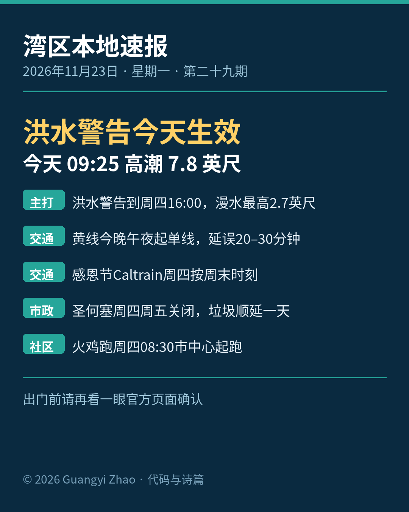

《湾区本地速报》第二十九期，2026年11月23日，星期一，五条本地新闻：

**主打·天气**：国家气象局旧金山今晨（11月23日 06:10）发布海岸危险通告：**沿海洪水警告**持续到周四（11月26日）16:00，湾岸低洼一带漫水最高 2.7 英尺，可能多处道路封闭。旧金山潮位站高潮：今天（周一）09:25 为 7.8 英尺（高于正常 2.0 英尺）、周二 10:05 为 8.2 英尺、周三 10:49 最高 8.5 英尺、周四 11:38 为 8.0 英尺（MLLW），预测含最高 1.5 英尺增水，气象局称接近有记录以来的最高潮位。另外，太平洋海岸有大浪警告（周二午夜至周三午夜），碎浪 20 到 30 英尺。本期数字以今晨新通告为准，昨日通告的漫水 2.8 英尺与今天高潮 8.0 英尺已作废。

**交通**：BART 黄线铁路去应力施工今晚（11月23日）进行，午夜起在 Lafayette 至 Walnut Creek 区间单线运行，一直持续到次日服务开始，延误 20 到 30 分钟，夜里坐黄线请多留时间。

**感恩节交通**：Caltrain 周四（11月26日）感恩节按周末时刻运行，周五（11月27日）按修改时刻运行，出门前请先查官方时刻表。BART 周四按周日时刻运行，早上 8 点到午夜。

**市政**：圣何塞市政服务本周四、周五（11月26、27日）感恩节假期关闭，公共安全与公用事业照常。感恩节当天不收垃圾和回收，常规收运日在感恩节当天或之后的，顺延一天。

**社区**：硅谷感恩节火鸡跑本周四（11月26日）早上 8:30 在圣何塞市中心西圣克拉拉街与北第一街路口起跑，5 公里与 10 公里同时开始，儿童趣味跑 10:15；赛方称其为全美最大感恩节赛事。87 号公路 Julian 出口赛日 7:45 后封闭，请提前绕行。

来源：[国家气象局海岸洪水警告（forecast.weather.gov，2026-11-23 06:10）](https://forecast.weather.gov/wwamap/wwatxtget.php?cwa=mtr&wwa=coastal+flood+warning) · [BART 黄线施工通告](https://www.Bart.Gov/news/articles/2025/news20250326-1) · [Caltrain 感恩节修改时刻表（官方 PDF）](https://www.caltrain.com/media/38107) · [圣何塞市府通告 News 7648](https://www.sanjoseca.gov/Home/Components/News/News/7648/) · [硅谷感恩节火鸡跑官网](https://www.svturkeytrot.com/general-race-info/)

数字证据说明：本期五条中沿海洪水通告、黄线施工、市政安排、火鸡跑为 A 级（官方原文，核对日期 2026-11-23）；感恩节交通时刻中 Caltrain 为 A 级官方时刻表、BART 时刻为 B 级汇总口径。所有漫水与高潮数字均为通告预报口径。

*《湾区本地速报》为《代码与诗篇》新闻矩阵第 8 档，每日早上更新。播报版（音频/视频）同日发布于 YouTube「Ezra Daily 每日速报」。© 2026 Guangyi Zhao*
