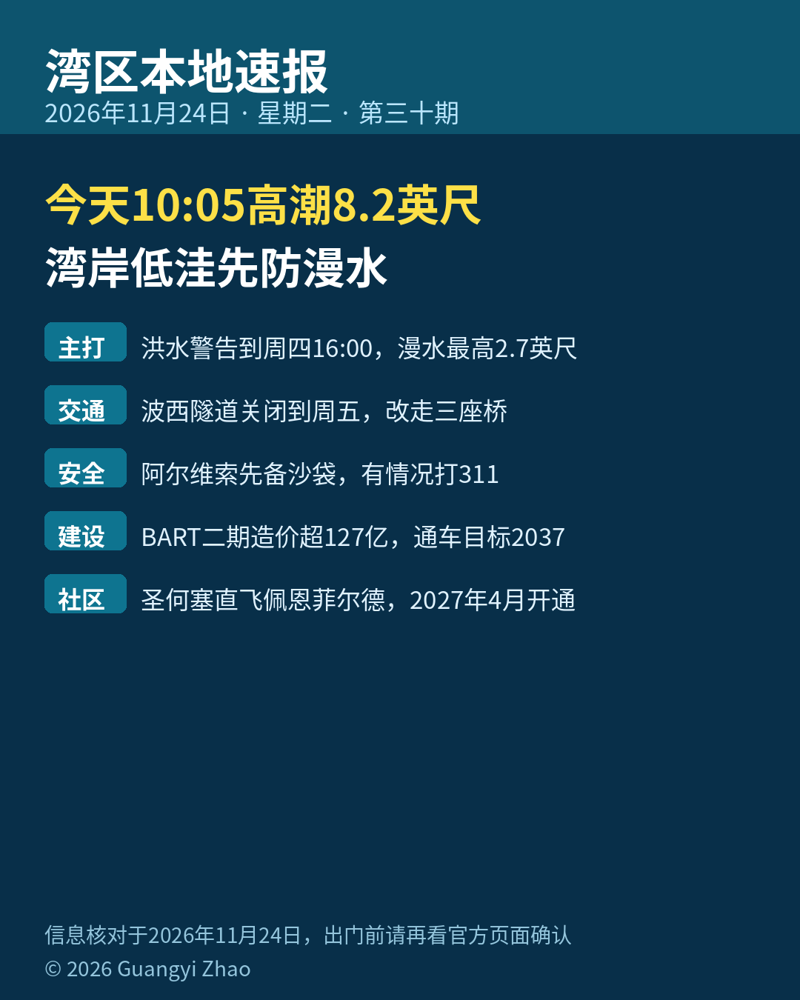

《湾区本地速报》第三十期，2026年11月24日，星期二，五条本地新闻：

**主打·天气**：国家气象局旧金山海岸危险通告（2026-11-23 13:10 PST 发布）：**沿海洪水警告**持续到周四（11月26日）16:00，湾岸低洼一带漫水最高 2.7 英尺，可能多处道路封闭。旧金山潮位站高潮：今天（周二）10:05 为 8.2 英尺（高于正常 2.4 英尺）、周三 10:49 最高 8.5 英尺、周四 11:38 为 8.0 英尺，预测含最高 1.5 英尺增水，气象局称接近有记录以来的最高潮位。太平洋海岸另有大浪警告（周二午夜至周三午夜），碎浪 20 到 30 英尺。今晚湾区还有降雨，出门请先看路况。

**交通**：Caltrans 已预防性关闭阿拉米达出城方向的波西隧道（Posey Tube，州道 260），关闭期为 11月22日周日 20:00 至 11月27日周五 17:00，车辆、自行车与行人全程禁行，目的是防国王潮洪水损坏隧道。去奥克兰请改走 Park Street Bridge（指定绕行）、Fruitvale Avenue Bridge 或 High Street Bridge；进阿拉米达的 Webster Tube 照常通行。AC Transit 19、30、51A、96、851 及跨湾 O、W 线绕行，会有延误。

**安全**：圣何塞市与 Valley Water 11月23日提醒北圣何塞阿尔维索（Alviso）居民先做防洪准备：市应急行动中心已启用，正在监测 60 处有洪涝或滑坡历史的点位，全县设 5 处沙袋点。官员表示目前不预计发生大洪水，但公园与低洼处可能积水；有情况请打 311，不要开车穿过积水路面。

**交通建设**：VTA 表示，硅谷 BART 二期（6 英里、4 站）造价将明显超过现估 127 亿美元，新估价与进度安排 12 月底交监督委员会；通车目标 2037 年，隧道施工预计 2028 年初开始。VTA 正评估分期推进等适应方案，六英里四站的完整延伸仍是目标。

**社区交通**：阿拉斯加航空宣布，2027年4月14日起开通圣何塞机场（SJC）直飞西雅图佩恩菲尔德机场（Paine Field）的航线，每天 2 班，由 Horizon Air 运营、Embraer 175 执飞，南湾往返西雅图北边多一个直飞选择。

来源：[国家气象局海岸洪水警告（forecast.weather.gov，2026-11-23 13:10）](https://forecast.weather.gov/wwamap/wwatxtget.php?cwa=mtr&wwa=coastal+flood+warning) · [Caltrans 波西隧道关闭通告（2026-11-20）](https://dot.ca.gov/caltrans-near-me/district-4/d4-news/2026-11-20-posey-tube) · [San José Spotlight：阿尔维索防洪准备（2026-11-23）](https://sanjosespotlight.com/?p=243757) · [The San Jose Blog：VTA BART 二期造价（2026-11-22）](https://www.thesanjoseblog.com/2026/11/vta-flags-rising-costs-and-longer.html) · [阿拉斯加航空官方新闻稿](https://news.alaskaair.com/destinations/alaska-airlines-strengthens-its-seattle-area-network-with-major-paine-field-growth/)

数字证据说明：本期五条中沿海洪水通告、波西隧道关闭、新航线为 A 级（官方原文，核对日期 2026-11-24）；阿尔维索防洪准备与 BART 二期造价为 B 级（可靠媒体报道、多源一致，关键数字未经一手原文终核）。所有漫水与高潮数字均为通告预报口径。

*《湾区本地速报》为《代码与诗篇》新闻矩阵第 8 档，每日早上更新。播报版（音频/视频）同日发布于 YouTube「Ezra Daily 每日速报」。© 2026 Guangyi Zhao*
